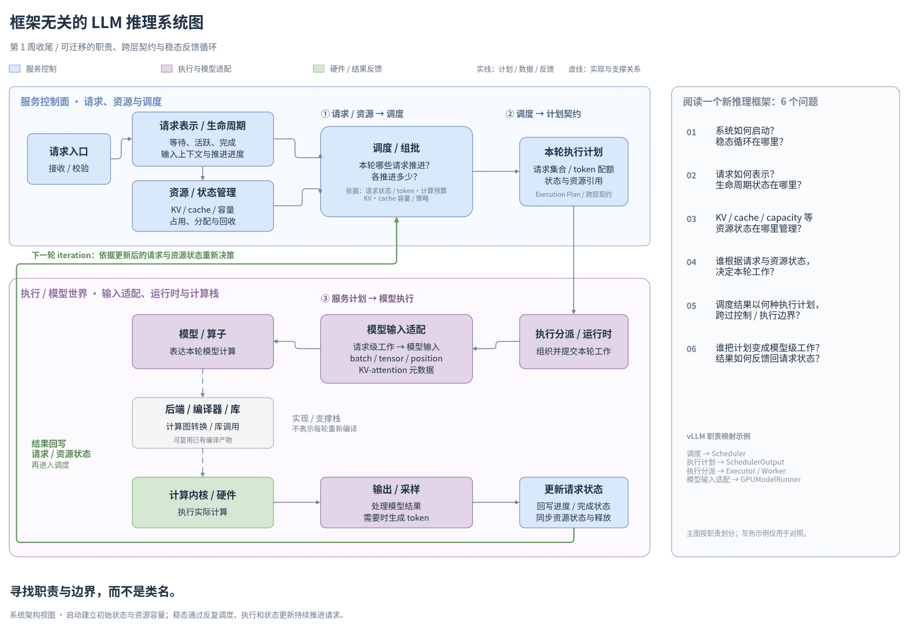
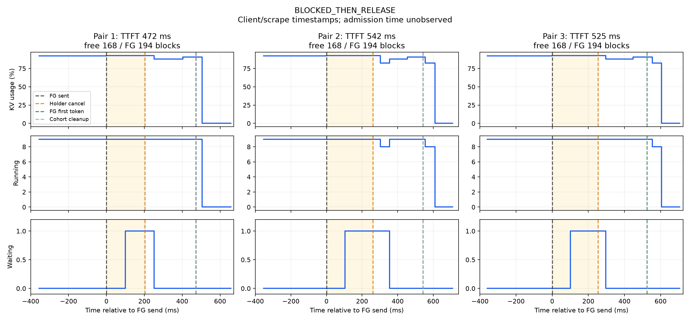
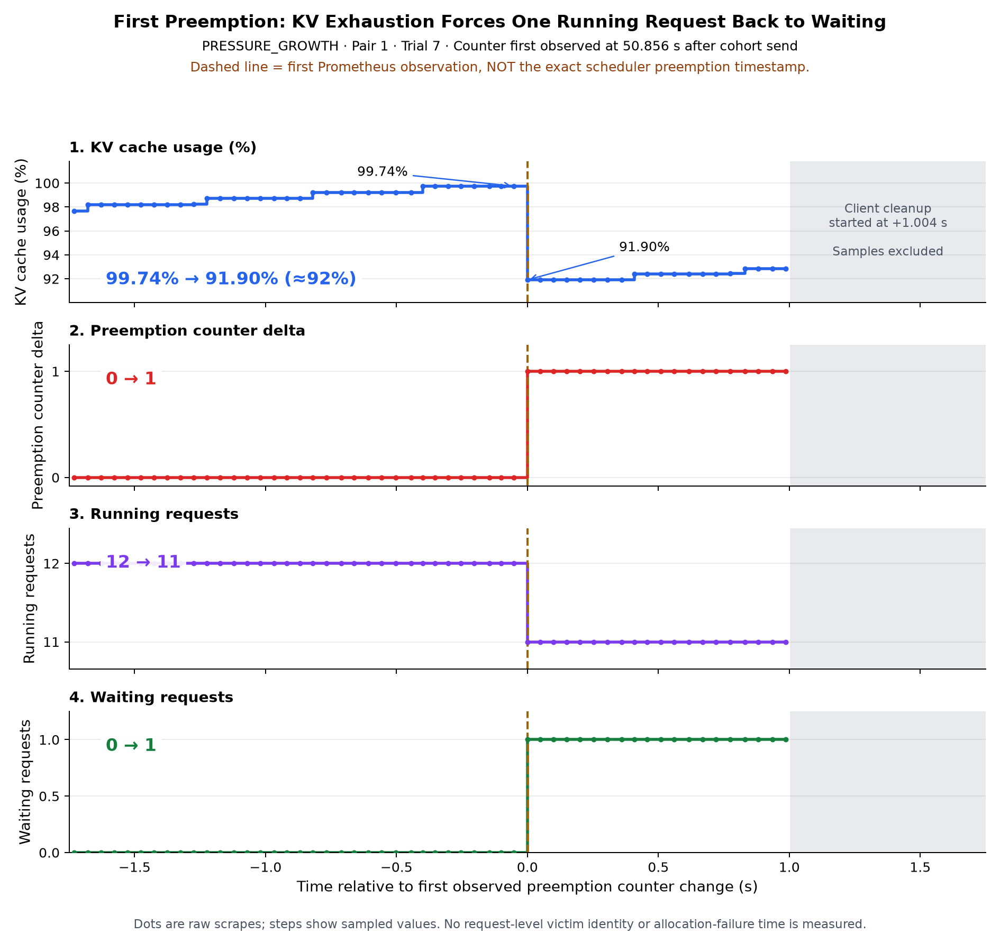

# vllm-playground

这是我 Week 1 的 AI Infra / LLM inference 学习记录。
从 serving behavior 出发，通过实验理解 mechanism，再用 production source validation 校准认识。
最后整理成 framework-independent abstraction，留下阅读其他推理框架时可复用的职责与边界。

**实验 baseline：vLLM 0.31.0 / Qwen3-0.6B / single RTX 4060 Laptop GPU。**

这张图是本周的收尾：一个请求如何被组织成多轮 work，以及计划如何跨过 serving / model execution 边界。

## Week 1

路线：**experiments → mechanism → source validation → abstraction**。

实际做了 prompt length、output length、concurrency、Prefill–Decode interference、
token budget / Chunked Prefill，以及 KV pressure / admission / preemption 六组探索。
从客户端延迟和输出事件、服务端 Running / Waiting 与 KV 指标入手，逐步追问背后的调度和资源机制。
最后沿实际使用的单 GPU、V2 ModelRunner 路径阅读源码，并补齐 startup 与 steady-state lifecycle。

### What I observed

#### 1. Prompt length：输入变长，TTFT 明显增加

实际 prompt 中位数从约 **77 → 2229 tokens**，TTFT 中位数从 **11.8 → 120.4 ms**。
更长的输入增加 Prefill 工作；Decode 也有所变慢，但本次 TTFT 对输入长度更敏感。
来源：[Prompt length](notes/week1-experiments.md#prompt-length)，run `20261006-222435`。

#### 2. Output length：更多输出主要增加 Decode 步数与 E2E

固定约 577-token 输入，输出上限从 **16 → 512 tokens**，E2E 近似线性增长。
TTFT 中位数保持在 **32.5–34.7 ms**；TPOT 约 **6.3–6.6 ms/token**，未观察到随输出长度强单调增加。
来源：[Output length](notes/week1-experiments.md#output-length)，run `20261006-225619`。

#### 3. Concurrency：aggregate throughput 提高，individual latency 恶化

正式并发实验中，C=1 → 32，generation throughput 从 **158.7 → 1415.2 tokens/s**；
同时 E2E p50 从 **0.797 → 2.884 s**，TPOT p50 从 **6.02 → 20.49 ms/token**。
系统处理的总工作量增加，单个请求的推进却变慢了。
来源：[Concurrency 正式记录](notes/week1-experiments.md#concurrency)，run `20261010-231439-7f9be14b`。

#### 4. Prefill–Decode interference：新 Prefill 会打断背景输出节奏

八个请求已在 Decode 时注入 Short / Long prompt，stall ratio 中位数分别为 **3.834 / 12.576**，
无注入 Baseline 为 **1.297**。干扰集中在注入附近，随后输出间隔恢复到通常的短间隔。
来源：[Mixed Prefill–Decode interference](notes/week1-experiments.md#mixed-prefilldecode-interference)，run `20261011-213351-40137cab`。

时间线保留正常输出节奏、注入附近的长间隔与后续恢复；颜色和线段长度表示客户端事件间隔。

#### 5. Token budget / Chunked Prefill：更少、更重的 decode stall

在已有八个请求 Decode 时注入 long prompt，budget 从 1024 → 4096，
long prefill 的 TTFT 中位数从 **217.224 → 199.408 ms**；
背景输出的超阈值间隔数从 **3 → 1**，峰值间隔的汇总中位数从 **72.287 → 181.705 ms**。
这次观察到的是更少、更重的 decode stall，没有得到通用最优 budget。
时间线中 1024 / 2048 / 4096 对应 **3 / 2 / 1** 个相邻超阈值间隔；它们是客户端事件间隔，不等于 GPU stall 或 scheduler 轮数。
来源：[Token budget 正式记录](notes/week1-experiments.md#token-budget--chunked-prefill)，run `20261012-210208-840f1f50`。

#### 6. KV pressure：分别观察 admission blocking 与 preemption

Compute/token budget 限制本轮安排多少工作，KV capacity 限制请求状态能否容纳、能否继续增长。
Admission 实验中，前台需要 **194 blocks**、触发时仅余 **168 blocks**：先注入会等待，释放 holder 后继续推进；反转顺序后无持续等待。
Growth 实验让已接纳请求的 Decode context 增长，三次压力试验均在采样 KV 使用率 **99.74–99.78%** 附近观察到一次 preemption，对照组没有抢占。
来源：[KV pressure 正式记录](notes/week1-experiments.md#kv-pressure--admission--preemption)与[实验协议](notes/kv-pressure-experiment.md)，run `formal-20261013`。

放大图展示 Pair 1 / trial 7：KV **99.740% → 91.905%**、preemption **0 → 1**、Running **12 → 11**、Waiting **0 → 1**。
虚线是首次指标观测时刻；[三组 growth 对照](notes/pics/kv-pressure-growth-comparison.png)展示重复性，[反转注入顺序的 admission 对照](notes/pics/kv-pressure-release-then-inject.png)补充资源释放证据。

实验之后，[CP1–CP7 production source trace](notes/vllm-source-trace.md) 用来校准 mental models：
区分入队与 admission、调度计划与实际执行，确认谁管理资源、谁决定工作、谁把计划变成模型输入。
最终保留的是 responsibilities / boundaries 与反馈循环，类名只是当前实现的定位线索。

这些结论来自 single GPU、small model 和有限轮次的 educational exploration。
它们用于理解当前 workload 的系统行为，不作为硬件 benchmark 或通用性能结论；测量定义与局限见完整记录。

## Artifacts

- [notes/week1-experiments.md](notes/week1-experiments.md) — 完整 Week 1 实验记录与正式 run 索引。
- [notes/vllm-source-trace.md](notes/vllm-source-trace.md) — CP1–CP7 production source trace。
- [notes/kv-pressure-experiment.md](notes/kv-pressure-experiment.md) — KV pressure 两组机制实验的协议与执行记录。
- [notes/pics/](notes/pics/) — 精选实验图。
- [notes/diagrams/](notes/diagrams/) — 源码与系统心智模型图。
- [experiments/](experiments/) — 实验、分析与绘图代码。
- [scripts/serve_qwen3_0_6b.sh](scripts/serve_qwen3_0_6b.sh) — 本地服务基线：GPU memory utilization 0.75、max model length 4096。

三张 Week 1 收尾图统一收录在 `notes/diagrams/`，下面提供预览与可编辑源文件：

| 图 | 文件 |
|---|---|
| Startup / Initialization Lifecycle | [PNG](notes/diagrams/vllm-startup-lifecycle.png) · [draw.io](notes/diagrams/vllm-startup-lifecycle.drawio) |
| Steady-State Request Lifecycle | [PNG](notes/diagrams/vllm-steady-state-request-lifecycle.png) · [draw.io](notes/diagrams/vllm-steady-state-request-lifecycle.drawio) |
| Framework-Independent LLM Inference System Map | [PNG](notes/diagrams/llm-inference-system-map.png) · [draw.io](notes/diagrams/llm-inference-system-map.drawio) |

Raw results（CSV、事件 JSONL、server logs 等）主要保存在本地、被 gitignore 排除的 `results/`。
仓库版本化保存实验代码、正式记录和精选图；完整测量细节由记录中的 run ID 对应到本地原始数据。

## Where this leads

Week 1 主要回答：现代 inference system 如何组织 work。
Week 2 将沿已经定位的模型执行边界，下沉到 execution runtime / operators / kernels / GPU，
观察这些 work 如何被高效执行。
