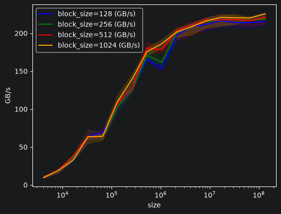

triton 初探：从向量加法开始
---

# 1. 什么是 Triton

# 2. Triton vector add 示例分析

# 3. Triton jit生成了什么？

默认情况下，Triton 会将 kernel jit 编译为 PTX 代码，并将其缓存到 `~/.triton/cache` 目录下。
```bash
(vllm-playground) boran@fedora:~/PycharmProjects/vllm-playground$ find ~/.triton/cache -type f -printf '%T@ %p\n' \
  | sort -nr \
  | head -40
1792473379.3157854740 /home/boran/.triton/cache/V5QP4W4JXLYVIHQ5FHOMFYDRMT7S4TIJNHPVFAL2LI4UYZCCHPEQ/__grp__add_kernel.json
1792473379.3156898140 /home/boran/.triton/cache/V5QP4W4JXLYVIHQ5FHOMFYDRMT7S4TIJNHPVFAL2LI4UYZCCHPEQ/add_kernel.json
1792473379.3155340400 /home/boran/.triton/cache/V5QP4W4JXLYVIHQ5FHOMFYDRMT7S4TIJNHPVFAL2LI4UYZCCHPEQ/add_kernel.cubin
1792473379.1920877050 /home/boran/.triton/cache/V5QP4W4JXLYVIHQ5FHOMFYDRMT7S4TIJNHPVFAL2LI4UYZCCHPEQ/add_kernel.ptx
1792473379.1895692100 /home/boran/.triton/cache/V5QP4W4JXLYVIHQ5FHOMFYDRMT7S4TIJNHPVFAL2LI4UYZCCHPEQ/add_kernel.llir
1792473379.1844942180 /home/boran/.triton/cache/V5QP4W4JXLYVIHQ5FHOMFYDRMT7S4TIJNHPVFAL2LI4UYZCCHPEQ/add_kernel.ttgir
1792473379.1817735920 /home/boran/.triton/cache/V5QP4W4JXLYVIHQ5FHOMFYDRMT7S4TIJNHPVFAL2LI4UYZCCHPEQ/add_kernel.ttir
1792473379.1806834080 /home/boran/.triton/cache/V5QP4W4JXLYVIHQ5FHOMFYDRMT7S4TIJNHPVFAL2LI4UYZCCHPEQ/add_kernel.source
1791272303.0766447070 /home/boran/.triton/cache/MIH4X24CEAJDWYGXCZ4EKW6DTWSUG2ZBSBPV7NGI62HAUKJ7F7BQ/cuda_utils.cpython-312-x86_64-linux-gnu.so
```

编译的顺序可能是什么样的呢？
```text
add_kernel.source
        ↓
add_kernel.ttir
        ↓
add_kernel.ttgir
        ↓
add_kernel.llir
        ↓
add_kernel.ptx
        ↓
add_kernel.cubin
```

他们是什么:

| 文件 | 可以怎么理解 | 现在要不要懂 |
|---|---|---:|
| `.source` | JIT 的源输入/源信息缓存 | 看一眼即可 |
| `.ttir` | Triton IR，较高层 Triton 中间表示 | 知道存在 |
| `.ttgir` | Triton GPU IR，加入 GPU layout/mapping 等信息 | 知道存在 |
| `.llir` | LLVM IR | 不需要学 |
| `.ptx` | NVIDIA PTX 虚拟 ISA | 可以随便看一眼 |
| `.cubin` | NVIDIA GPU 可加载的二进制 | 知道它是最终 binary |
| `.json` | kernel 编译 metadata | 可以看 |
| `__grp__*.json` | Triton cache 的“这一组文件有哪些”的索引 | 不需要研究 |
| `cuda_utils...so` | Triton runtime 的 Python/CUDA 辅助扩展 | **不是这次 add_kernel 编译产物** |

# 4.Benchmark

这是根据官方代码改写的一个简单 benchmark。

```jupyterpython
@triton.testing.perf_report(
    triton.testing.Benchmark(
        x_names=['size'],  # Argument names to use as an x-axis for the plot.
        x_vals=[2 ** i for i in range(12, 28, 1)],  # Different possible values for `x_name`.
        x_log=True,  # x axis is logarithmic.
        line_arg='block_size',  # Argument name to use as a line in the plot.
        line_vals=[128,256, 512, 1024],  # Different possible values for `line_arg`.
        line_names=['block_size=128', 'block_size=256', 'block_size=512', 'block_size=1024'],  # Label names for the lines.
        styles=[('blue', '-'), ('green', '-'), ('red', '-'), ('orange', '-')],  # Line styles.
        ylabel='GB/s',  # Label name for the y-axis.
        plot_name='vector-add-blocksize',  # Name for the plot. Used also as a file name for saving the plot.
        args={},  # Values for function arguments not in `x_names` and `y_name`.
    ))
def benchmark(size, block_size):
    x = torch.rand(size, device=DEVICE, dtype=torch.float32)
    y = torch.rand(size, device=DEVICE, dtype=torch.float32)
    quantiles = [0.5, 0.2, 0.8]


    ms, min_ms, max_ms = triton.testing.do_bench(lambda: add(x, y, block_size=block_size), quantiles=quantiles)
    gbps = lambda ms: 3 * x.numel() * x.element_size() * 1e-9 / (ms * 1e-3)
    return gbps(ms), gbps(max_ms), gbps(min_ms)
```

## 结果分析

```text
<Figure size 640x480 with 1 Axes>
vector-add-blocksize:
           size  block_size=128 (GB/s)  block_size=256 (GB/s)  block_size=512 (GB/s)  block_size=1024 (GB/s)
0        4096.0               9.600000               9.600000               9.600000                9.600000
1        8192.0              19.200000              19.200000              19.200000               19.200000
2       16384.0              32.251968              37.012049              38.400001               32.768000
3       32768.0              63.999998              63.999998              63.999998               63.340206
4       65536.0              68.936888              63.999998              63.999998               63.999998
5      131072.0             101.869432             102.400003             107.553613              109.714284
6      262144.0             127.999995             125.869397             127.999995              139.636363
7      524288.0             166.054047             170.666661             180.705879              175.542852
8     1048576.0             153.780216             161.684218             178.086953              186.181817
9     2097152.0             196.804797             200.466986             203.107443              201.442627
10    4194304.0             209.157447             209.659295             210.416592              208.271180
11    8388608.0             211.406456             216.030492             217.486722              216.216095
12   16777216.0             216.647938             217.246410             217.505524              220.907859
13   33554432.0             213.936885             218.089851             217.893464              220.289079
14   67108864.0             214.004197             216.916838             216.767370              220.167659
15  134217728.0             215.963757             218.783793             220.906891              225.597246

```

1. tile size 确实会影响 kernel performance。
2. 它对不同 workload size 的影响程度不同。
3. 一旦 kernel 被更强的硬件瓶颈——这里是 memory bandwidth——限制，tile 参数的重要性就下降。