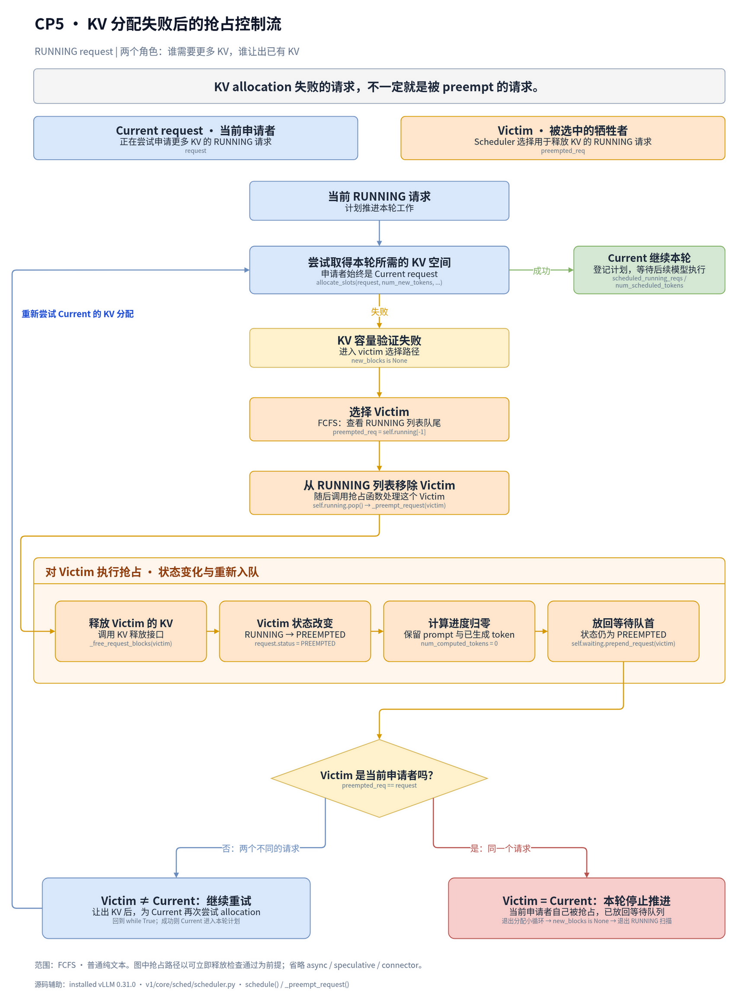
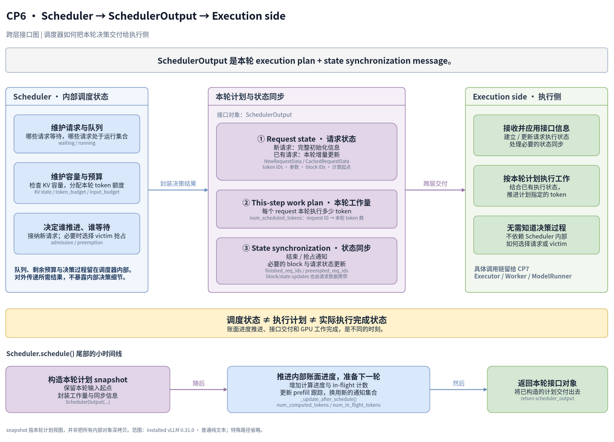
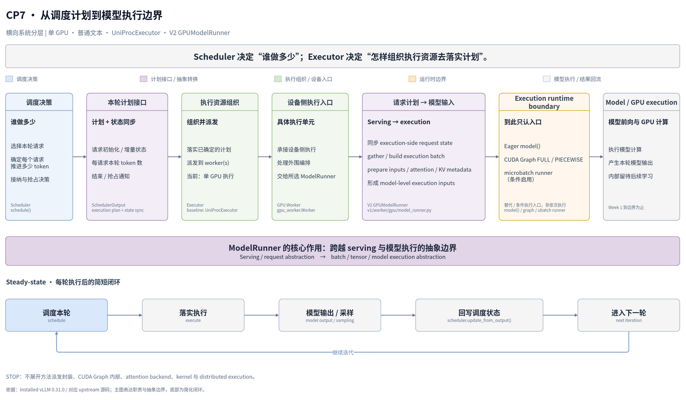

vllm 源码探究
---

# 需要搞懂的问题
1. 一个请求在哪里从“API request”变成 engine 内部的 Request？
2. WAITING 和 RUNNING 到底是谁维护的？
3. Scheduler.schedule() 一轮究竟在算什么？
4. num_new_tokens、token budget 在哪里限制本轮工作量？
5. KV block 的需求在哪里计算，allocate_slots() 返回失败意味着什么？
6. Scheduler 一轮结束以后到底产出什么对象？
7. ModelRunner 拿到这个结果后，如何把它变成真正的 model execution？

# checkpoint1

## 阅读指导

**Checkpoint 1：内部 Request 的创建与进入 waiting**

本次只跟踪一个**普通、新建、非 streaming 的文本生成请求**。下面链接打开 installed source；submodule 中对应 `third_party/vllm/vllm/` 下的同名路径，关键文件内容一致。

先打开 [v1/engine/core.py](/home/boran/PycharmProjects/vllm-playground/.venv/lib/python3.12/site-packages/vllm/v1/engine/core.py)，从 `EngineCore.preprocess_add_request()` 开始。围绕它做以下几个小跳转，都属于同一个 checkpoint：

| 顺序 | 文件 / 类 / 函数 | 本次阅读范围 |
|---|---|---|
| 1 | `core.py` → `EngineCore.preprocess_add_request()` | 看 `Request.from_engine_core_request(...)` 的对象转换与返回值 |
| 2 | [v1/request.py](/home/boran/PycharmProjects/vllm-playground/.venv/lib/python3.12/site-packages/vllm/v1/request.py) → `Request.from_engine_core_request()`、`Request.__init__()` | 看字段传递，以及 `status`、`num_computed_tokens` 的初始化 |
| 3 | `core.py` → `EngineCoreProc.process_input_sockets()`、`_handle_client_request()`、`EngineCore.add_request()` | 只看 ADD 接收、输入队列交接、ADD 分派和交给 scheduler 的调用 |
| 4 | [v1/core/sched/scheduler.py](/home/boran/PycharmProjects/vllm-playground/.venv/lib/python3.12/site-packages/vllm/v1/core/sched/scheduler.py) → `Scheduler.add_request()` | 看是否已有同 ID 请求，再看新请求的 else 分支 |
| 5 | 同一 `scheduler.py` → `_enqueue_waiting_request()` 及两个判断辅助函数 | 看阻塞状态判断、是否持有 KV blocks 的判断；回看 `Scheduler.__init__()` 的容器定义 |

这次阅读只回答三个问题：

1. `EngineCoreRequest` 在哪里变成内部 `Request`？`WAITING` 初始状态由谁设置？
2. `EngineCore.add_request()` 把请求交给谁？新请求最终加入哪个队列，又登记在哪个字典？
3. 这条新请求入队路径有没有调用 `allocate_slots()`，或把请求加入 `self.running`？据此，**进入 waiting 与 admission 是否是同一步？**

与实验的对应：这里先把 **Running / Waiting** 从观测指标对应到实际容器，再辨认 **Continuous Batching** 的请求入口与后续调度的分界。你在 homogeneous concurrency 实验里同时发出的多个请求，可以先逐个套进这条入队路径；它们何时获得 KV 空间、进入 RUNNING，留到后面的 admission checkpoint。

## 探索中的问题与结论

### 1. EngineCoreRequest 是什么，从哪里来？

它是前端交给 EngineCore 的请求数据结构，定义在 `v1/engine/__init__.py`。常规路径由 `InputProcessor.process_inputs()` 构造，携带输入 token、采样参数、请求 ID 等；跨进程时经 EngineCoreClient 编码发送。

以下是 `EngineCoreRequest` 中部分原始字段定义：

```python
request_id: str
prompt_token_ids: list[int] | None
mm_features: list[MultiModalFeatureSpec] | None
sampling_params: SamplingParams | None
pooling_params: PoolingParams | None
arrival_time: float
lora_request: LoRARequest | None
cache_salt: str | None
data_parallel_rank: int | None
```

### 2. 为什么还要转换成内部 Request，是否舍弃字段？

`Request.from_engine_core_request()` 保留执行所需输入，并通过构造函数建立可变执行状态：`status`、输出 token、`num_computed_tokens`、抢占计数等。`data_parallel_rank` 用于 client 路由；`current_wave` 单独返回并传递；`external_req_id` 的映射由前端 OutputProcessor 保存。

以下摘录 `Request.__init__()` 中分散的初始化语句：

```python
self.status = RequestStatus.WAITING
self._output_token_ids: list[int] = []
self.num_computed_tokens = 0
self.num_preemptions = 0
```

生成请求的 `self.max_tokens` 来自 `sampling_params.max_tokens`，限制单个请求的输出长度；它与 scheduler 每轮的 `max_num_batched_tokens` 不同。

### 3. cache_salt 是否说明跨用户复用会串对话？

`cache_salt` 是可选的缓存隔离条件，不同 salt 可以隔离相同前缀，但不会自动识别用户。相同模型及相关计算条件下，共享相同前缀的 KV 本身不会串对话；隔离也可避免跨租户通过命中耗时探测前缀。TODO：后续看 `kv_cache_utils.py` 中缓存 hash 如何加入 salt。

### 4. 状态为什么不只有 WAITING / RUNNING？

`RequestStatus` 还区分等待 grammar、远端 KV、streaming 输入等条件，以及不同结束原因。`PREEMPTED` 单独记录被抢占但尚未结束的请求；`is_finished()` 通过 `status > PREEMPTED` 判断结束。状态与所属队列不是一回事，实验中的 Waiting / Running 是汇总指标。

以下摘录状态枚举成员与结束判断，中间省略其他方法：

```python
WAITING = enum.auto()
WAITING_FOR_STRUCTURED_OUTPUT_GRAMMAR = enum.auto()
WAITING_FOR_REMOTE_KVS = enum.auto()
WAITING_FOR_STREAMING_REQ = enum.auto()
RUNNING = enum.auto()
PREEMPTED = enum.auto()
# Note: anything after PREEMPTED will be considered
# as a finished status.
FINISHED_STOPPED = enum.auto()
FINISHED_LENGTH_CAPPED = enum.auto()
FINISHED_ABORTED = enum.auto()
FINISHED_IGNORED = enum.auto()
FINISHED_ERROR = enum.auto()
FINISHED_REPETITION = enum.auto()
```

```python
@staticmethod
def is_finished(status: "RequestStatus") -> bool:
    return status > RequestStatus.PREEMPTED
```

### 5. process_input_sockets 做什么，如何接上之前的函数？

它是 EngineCore 侧后台输入线程入口。对 ADD：ZMQ 接收 → 解码为 `EngineCoreRequest` → `preprocess_add_request()` → 内部 `Request` → 写入 `input_queue`。ZMQ 是消息通信库，可使用 IPC 或 TCP；这里先把它当作进程间消息通道。

### 6. 谁读取 input_queue，怎么找到调用者？

`_process_input_queue()` 读取消息并调用 `_handle_client_request()`，后者按 ADD / ABORT / UTILITY 等类型分发。ADD 再经 `EngineCore.add_request()` 到 `Scheduler.add_request()`。查调用者可用 PyCharm 的 Find Usages；跨队列衔接时，要同时追写入和读取。

对应的写入语句与非阻塞读取片段分别是：

```python
self.input_queue.put_nowait((request_type, request))
```

```python
while not self.input_queue.empty():
    req = self.input_queue.get_nowait()
    self._handle_client_request(*req)
```

### 7. EngineCore 是多线程的吗，还有输出队列吗？

这里有后台输入线程、engine 主循环和后台输出线程。输入线程写 `input_queue`，主循环处理消息并推进执行、写 `output_queue`，`process_output_sockets()` 读取输出并发送。ABORT 同时写 `aborts_queue` 和 `input_queue`：前者允许尽早处理，后者保留消息顺序；取消处理是幂等的。

### 8. run_busy_loop 的骨架和两段输入处理是什么意思？

外层每轮处理输入消息、发布计数、推进 engine step、再发布计数。输入处理分两段：没有执行工作时阻塞等消息，直到有工作；随后非阻塞地处理已到达消息，队列空了就返回执行。`has_work()` 不等于消息队列非空；第一段也不是只 try 一次。合成一个循环也可实现，两段只是明确不同等待与退出条件。

`EngineCoreProc.run_busy_loop()` 的原始骨架：

```python
@fault_tolerant_wrapper
def run_busy_loop(self):
    """Core busy loop of the EngineCore."""
    while self._handle_shutdown():
        # 1) Poll the input queue until there is work to do.
        self._process_input_queue()
        # Publish request counts before and after GPU step to ensure freshness.
        self._maybe_publish_request_counts()
        # 2) Step the engine core and return the outputs.
        self._process_engine_step()
        self._maybe_publish_request_counts()

    raise SystemExit
```

第一段的循环条件是 `while not self.has_work() and self.is_running()`；其读取片段如下。默认可阻塞等消息，配置为非阻塞时，空队列由 `queue.Empty` 处理；第二段使用上面的 `get_nowait()` 循环。

```python
block = self.process_input_queue_block
try:
    req = self.input_queue.get(block=block)
    self._handle_client_request(*req)
except queue.Empty:
    break
if not block:
    break
```

### 9. KVConnector / ECConnector 与传递参数是什么关系？

两者是可选传输组件：KVConnector 传递 KV cache，例如 prefill / decode 分离；ECConnector 传递 encoder cache，例如多模态编码与后续执行分离。请求中的 transfer params 是传输信息，connector 是处理它的组件；`EngineCore.add_request()` 此处只检查并打印缺少组件的 warning。TODO：具体传输机制暂不深入。

### 10. _enqueue_waiting_request 是不是只入队？

是。受条件阻塞的请求加入 `deferred_waiting` 集合，同时按是否持有 KV blocks 进入 `kv_holding_waiting` 或 `waiting`，两个 if 独立。普通新请求进入 `waiting`，外层还登记到 `self.requests`；此处没有分配 KV，也没有加入 RUNNING，入队与 admission 是不同步骤。

```python
def _enqueue_waiting_request(self, request: Request) -> None:
    if self._is_blocked_waiting_status(request.status):
        self.deferred_waiting.add(request)
    if self._holds_kv_blocks(request):
        self.kv_holding_waiting.add_request(request)
    else:
        self.waiting.add_request(request)
```

# checkpoint2

## 阅读指导

**Checkpoint 2：只看 `schedule()` 的顶层骨架。** 本次用函数名和关键语句定位，不列行数。仍以 installed source 为准；submodule 对应文件一致。

先打开 [v1/engine/core.py](/home/boran/PycharmProjects/vllm-playground/.venv/lib/python3.12/site-packages/vllm/v1/engine/core.py)。

| 函数 | 建议阅读的小范围 | 这一段观察什么 |
|---|---|---|
| `EngineCoreProc._process_engine_step()` | 从函数入口到 `outputs, model_executed = self.step_fn()` | 找到 engine step 实际调用的入口 |
| `EngineCore.__init__()` | 只看 `self.step_fn = (...)` 的赋值 | 确认它可能指向哪两个函数 |
| `EngineCore.step()` | 从函数入口读到 `self.scheduler.schedule(...)`，停止 | 找到普通路径的 scheduler 调用 |
| `EngineCore.step_with_batch_queue()` | 搜索其中的 `self.scheduler.schedule(...)`，只看外围 `if` | 标记另一条调用路径，不读 batch queue 机制 |

然后打开 [v1/core/sched/scheduler.py](/home/boran/PycharmProjects/vllm-playground/.venv/lib/python3.12/site-packages/vllm/v1/core/sched/scheduler.py)，进入 **`Scheduler.schedule()`**。按文件顺序做下面几个小跳转，暂时跳过循环内部的大段逻辑。

| 阅读范围的起止锚点 | 这一段观察什么 |
|---|---|
| 从函数入口，到 `token_budget = self.max_num_scheduled_tokens` 及紧邻的 `input_budget` 初始化 | 看本轮建立了哪些结果容器；标记 budget 的首次赋值 |
| 从注释 `First, schedule the RUNNING requests.`，到循环内 `request = self.running[req_index]` | 看 RUNNING 块的位置、循环条件和读取的容器 |
| 从注释 `Next, schedule the WAITING requests.`，到 `request = request_queue.peek_request()` | 看 WAITING 块的位置、外围条件和读取的容器；与上一块比较顺序 |
| 从注释 `Check if the scheduling constraints are satisfied.`，到这组 `assert` 结束 | 看请求处理之后有哪些顶层检查，只看检查对象 |
| 搜索 `new_reqs_data` 和 `cached_reqs_data` 的赋值，只看赋值及调用参数 | 看输出构造之前准备了哪些数据；不进入辅助函数 |
| 从 `scheduler_output = SchedulerOutput(...)` 到右括号 | 看本轮结果如何封装，先扫字段名 |
| 从注释 `Build the connector meta for ECConnector` 往后，读到 `return scheduler_output` | 看构造后还有哪些收尾调用，以及最终返回的位置；不进入被调用函数 |

另外只放三个书签，**不读机制**：

- **Token budget**：函数开头的 `token_budget = self.max_num_scheduled_tokens`。
- **首次 KV allocation 调用**：RUNNING 块内，注释 `Schedule newly needed KV blocks for the request.` 下的 `self.kv_cache_manager.allocate_slots(...)`。
- **Preemption 分支**：同一块内，注释 `Preempt the lowest-priority request.`；再定位其后的 `self._preempt_request(...)`，不进入函数。

## 探索中的问题与结论

### 调度骨架与后续阅读地图

这里的“输入”主要是 Scheduler 持有或通过管理器访问的状态，不是 `schedule()` 的形参；本轮 token budget 在函数入口初始化。图中保留主骨架与已观察的关键分支，其他辅助分支省略。末尾的模型执行仅标出后续方向。

**详细骨架**（点击图片查看 SVG）

[](diagrams/vllm-scheduler-checkpoint2-detailed.svg)


**简化主线**（点击图片查看 SVG）

[](diagrams/vllm-scheduler-checkpoint2-simplified.svg)

WAITING 的外围条件是 `not preempted_reqs and self._pause_state == PauseState.UNPAUSED`；因此 RUNNING 中发生实际抢占后，本轮会跳过 WAITING。图中的循环箭头表示扫描或重试入口，具体条件留给对应 checkpoint。

| 后续 checkpoint | 深入内容 |
|---|---|
| Checkpoint 3 | `num_new_tokens` 与本轮 token budget 的计算、裁剪 |
| Checkpoint 4 | WAITING admission 与 KV allocation |
| Checkpoint 5 | RUNNING growth、allocation 失败与 preemption |
| Checkpoint 6 | `SchedulerOutput` 的具体字段与交接接口 |

### 1. step 与 step_with_batch_queue 是否一个等结果，一个直接返回？

`EngineCoreProc._process_engine_step()` 调用 `step_fn()`；具体路径在 `EngineCore.__init__()` 中选择：

```python
self.step_fn = (
    self.step if self.batch_queue is None else self.step_with_batch_queue
)
```

两条路径都会调用 scheduler。`step()` 提交本轮 batch 后通过 `future.result()` 等结果；batch queue 路径满足条件时先返回主循环，之后仍会取出较早提交的 batch 并等结果。这里的提交单位是一轮 batch，返回也不是向 API 用户返回整个请求的完成结果。TODO：batch queue 机制。

### 2. _should_throttle_prefills 是否影响本轮 prefill？

它向 `schedule()` 传入一个可选的 prefill 节奏控制开关。普通 `EngineCore` 的实现如下，DP 版本则重写判断；返回 True 也不代表必然禁止所有 prefill，scheduler 还会结合其他条件。

```python
def _should_throttle_prefills(self) -> bool:
    """Whether to defer new prefills this step (DP prefill balancing).
    Overridden by the DP engine core; never throttles otherwise."""
    return False
```

TODO：DP prefill 节奏控制的具体条件。

### 3. RUNNING 和 WAITING 的处理顺序，以及预算是否共享？

RUNNING 先处理，WAITING 后处理；WAITING 使用同一轮剩余的 `token_budget`，没有重新获得一份预算。以下分别摘录两块的循环入口，以及 RUNNING 中扣减预算的语句：

```python
while req_index < len(self.running) and token_budget > 0:
```

```python
token_budget -= num_new_tokens
```

```python
while token_budget > 0:
```

这对应 Mixed Prefill–Decode interference / token budget 实验中的工作量竞争，但不能把顺序直接理解为 decode 先、prefill 后：RUNNING 也可能包含未完成的 chunked prefill。

### 4. 为什么 num_new_tokens 随限制不断减少？

已经观察到它会受到多种条件裁剪，然后用于申请本轮 KV 空间。它表示本轮计划为请求计算的 token 数，可包含 prefill 工作，并不专指新生成的输出 token。

```python
new_blocks = self.kv_cache_manager.allocate_slots(
    request,
    num_new_tokens,
    num_lookahead_tokens=self.num_lookahead_tokens,
)
```

TODO：初始工作量如何计算、各项预算如何裁剪；本次没有深入这些规则。

### 5. allocation 失败后，是否立即抢占某个请求？

已定位 RUNNING 中的失败分支：成功则退出分配循环；失败但 connector 有 pending block frees 时也先退出；否则继续选择 victim。以下代码只是选择候选，真正执行抢占在后面的 `_preempt_request()`：

```python
if self.policy == SchedulingPolicy.PRIORITY:
    preempted_req = max(
        self.running,
        key=lambda r: (r.priority, r.arrival_time),
    )
else:
    preempted_req = self.running[-1]
```

TODO：抢占如何改变状态、释放空间和重新入队。

### 6. 已在 RUNNING，是否意味着资源已经分配完成？

不意味着整个生命周期的 KV 空间已经提前分配。请求通常持有已有 blocks，后续逐轮、逐请求按需增长；容量够时不必新增 block，也不是每轮重新分配全部空间。申请空间的请求与 victim 可以不同，某个请求本轮尚未被遍历也可能成为 victim。

因此，RUNNING 不保证本轮一定执行，已有 KV blocks 也不保证后续增长有空间。这个结论限定于 KV 空间；其他资源各有管理方式。TODO：RUNNING growth 与 preemption 的具体机制。

### 7. 调度后的 assert 在检查什么？

以下是 `Scheduler.schedule()` 中的一组原始检查：

```python
total_num_scheduled_tokens = sum(num_scheduled_tokens.values())
assert total_num_scheduled_tokens <= self.max_num_scheduled_tokens

assert token_budget >= 0
assert input_budget >= 0
assert len(self.running) <= self.max_num_running_reqs
```

它们检查本轮总 token 数不超上限、两份剩余预算不为负，以及 RUNNING 请求数量不超上限。这是验证前面的调度结果，不是在这里才裁剪工作量；RUNNING 数量也不等于本轮安排计算的请求数量。TODO：`input_budget` 与 `token_budget` 的具体区别。

### 8. 新请求 / cached 请求数据是什么，构造 SchedulerOutput 后还有什么？

`new_reqs_data` 提供建立请求执行状态所需的信息，`cached_reqs_data` 为执行侧已有请求传递更新，也包含恢复请求；这里的 cached 不代表命中 prefix KV cache。构造输出就是将这些数据与本轮计划一起传参封装，以下摘录构造参数：

```python
scheduled_new_reqs=new_reqs_data,
scheduled_cached_reqs=cached_reqs_data,
num_scheduled_tokens=num_scheduled_tokens,
total_num_scheduled_tokens=total_num_scheduled_tokens,
```

附加 metadata 等处理之后，末尾更新调度状态并返回；返回值由 engine 的 `scheduler_output` 接住。

```python
with record_function_or_nullcontext("schedule: update_after_schedule"):
    self._update_after_schedule(scheduler_output)
return scheduler_output
```

TODO：输出字段的具体用途、状态更新，以及如何交给 ModelRunner。

### 9. 函数太长，如何梳理才有收获？

本次只沿“初始化 → RUNNING → WAITING → 检查与数据准备 → 构造输出 → 收尾返回”识别边界。WAITING 入口缩小为“外围条件 → 循环入口 → 选队列 → 取请求”；比较两块共享预算的关系，比只认函数位置更有意义。

当前最重要的三个认识：RUNNING 不等于本轮一定执行；WAITING 使用剩余预算；`schedule()` 产出本轮执行计划。具体的 token 计算、admission、preemption 和 KVCacheManager 内部留到后续 checkpoints。

# checkpoint3

## 阅读指导
**Checkpoint 3：只沿 `num_new_tokens` 的赋值和使用追踪，预计 20–30 分钟。** Installed 与 submodule 的 `scheduler.py` 仍一致。以下链接指向 installed source，不列行数。

主要文件是 [v1/core/sched/scheduler.py](/home/boran/PycharmProjects/vllm-playground/.venv/lib/python3.12/site-packages/vllm/v1/core/sched/scheduler.py)，函数为 **`Scheduler.schedule()`**。

| 顺序 | 最小阅读范围 / 锚点 | 这里观察什么 |
|---|---|---|
| 1 | 函数开头，只找 `token_budget = self.max_num_scheduled_tokens` 和 `input_budget = ...`；再找 `long_prefill_token_threshold = (...)` | 先认出后面裁剪会用到的预算与阈值。需要确认预算配置来源时，只跳到 `Scheduler.__init__()` 中 `self.max_num_scheduled_tokens` 的赋值 |
| 2 | RUNNING 块中第一次 `num_new_tokens = (...)`，只读这一个表达式 | 比较“请求已有的 token 范围”与“已安排计算的进度”，观察初始差额的语义 |
| 3 | 紧接着的 `if 0 < long_prefill_token_threshold < num_new_tokens:` 及赋值 | 观察这个阈值在什么条件下替换初值。先前的 adaptive threshold 配置分支标作 TODO |
| 4 | 紧接着的 `num_new_tokens = min(num_new_tokens, token_budget, input_budget - draft_slots)` | 观察单请求候选工作量如何受到**本轮剩余预算**限制；无 speculative decoding 时先按 `draft_slots == 0` 阅读 |
| 5 | 注释 `Make sure the input position does not exceed the max model len.` 下的第二个 `min(...)` | 观察模型长度的剩余空间如何成为另一项上限；不展开 speculative decoding 的原因 |
| 6 | 跳过特殊分支，找到 `if num_new_tokens == 0:`，只看 `req_index += 1`、`continue`；再找到 `allocate_slots(...)` 的调用参数 | 观察裁剪为零后如何停止当前请求的尝试，以及非零候选值在哪里交给 KV 分配接口 |
| 7 | 跳过分配循环内部，搜索注释 `Schedule the request.`，只读到两项 budget 扣减 | 观察成功后，哪个值被登记为本轮工作量、如何扣减共享预算 |

第二步只需额外打开 [v1/request.py](/home/boran/PycharmProjects/vllm-playground/.venv/lib/python3.12/site-packages/vllm/v1/request.py)，看 **`Request.num_tokens`、`Request.num_tokens_with_spec`** 两个短属性；不重新读构造函数。初值表达式中的 speculative token 和异步输出占位项先标为 **可选分支 / TODO**。

第五步之后，这三处也会接触或修改该变量，但此次只留下书签：

- `_mamba_block_aligned_split(...)`：**Mamba 对齐分支 / TODO**。
- `_try_schedule_encoder_inputs(...)`：**多模态 / encoder 分支 / TODO**。
- `_reserve_prefill_lookahead(...)`：**multi-module MTP 分支 / TODO**。

Connector、DP prefill throttling、structured output 等判断也跳过。

**Chunked Prefill 的观察点就在第三、第四步。** 取一个 prompt 尚未算完的 RUNNING 请求，手算一次：剩余 prompt 工作量为 `1000`，本轮剩余预算为 `128`；暂设其他上限不收紧。观察它经过这些赋值后，是否必须一次安排完整剩余 prompt。

第七步的停止位置是：

```python
num_scheduled_tokens[request_id] = num_new_tokens
token_budget -= num_new_tokens
input_budget -= num_new_tokens + draft_slots
```

读到这里就停，不进入 preemption 或 WAITING。

## 探索中的问题与结论

### 1. num_new_tokens如何变化？

| 顺序 | 代码表达式 | 生效条件 | 语义 | 普通主路径是否相关 |
|---|---|---|---|---|
| 1 | `num_new_tokens = request.num_tokens_with_spec + request.num_output_placeholders - request.num_computed_tokens` | 当前请求通过前置检查 | 请求的目标 token 范围减去调度账面进度，得到理论待计算量。`num_tokens_with_spec` 包含 prompt、已回传输出和 speculative tokens；placeholder 补充尚未回传的预期输出 | **相关**；无 spec 时 speculative 项为空，异步占位项另标 TODO |
| 2 | `num_new_tokens = long_prefill_token_threshold` | `0 < long_prefill_token_threshold < num_new_tokens`；有效阈值还要求不止一个请求竞争 | 用单请求阈值裁剪候选工作量 | 可选配置；**之前实验阈值为 0，不生效** |
| 3 | `num_new_tokens = min(num_new_tokens, token_budget, input_budget - draft_slots)` | 无条件执行；预算不足时才收紧 | 同时受本轮剩余调度预算和模型输入容量限制；未完成 prefill 可在这里被截为本轮的一部分 | **相关**；无 spec 时 `draft_slots = 0` |
| 4 | `num_new_tokens = min(num_new_tokens, self.max_model_len - request.num_computed_tokens - self.num_sampled_tokens_per_step)` | 无条件执行；接近模型长度边界时收紧 | 限制推进后的输入位置，保留每步采样所需的余量 | **相关**，普通自回归生成也经过此处 |
| 5 | `num_new_tokens = self._mamba_block_aligned_split(request, num_new_tokens)` | `self.need_mamba_block_aligned_split` | 接受 Mamba 对齐规则返回的工作量 | **Mamba 可选分支 / TODO**；Qwen3-0.6B 不走 |
| 6 | 元组赋值中的 `num_new_tokens`，来自 `self._try_schedule_encoder_inputs(...)` | `request.has_encoder_inputs` | 接受 encoder 调度返回的工作量，可能进一步裁剪 | **多模态 / encoder 可选分支 / TODO**；纯文本不走 |
| 7 | `num_new_tokens = self._reserve_prefill_lookahead(request, request.num_computed_tokens, num_new_tokens)` | 调用无条件；特殊 prefill lookahead 约束可能改变返回值 | 接受预留规则返回的工作量 | **MTP 可选约束 / TODO**；之前无 spec 的实验不收紧它 |
| 8 | `if num_new_tokens == 0: ... continue` | 裁剪结果为零 | 不再尝试为当前请求安排本轮工作；**不修改变量** | **相关的出口** |
| 9 | `self.kv_cache_manager.allocate_slots(request, num_new_tokens, num_lookahead_tokens=self.num_lookahead_tokens)` | 候选值非零并到达分配位置 | 把最终候选工作量交给 KV 分配接口；**此调用处不重新赋值该变量** | **相关**；不进入内部 |
| 10 | `num_scheduled_tokens[request_id] = num_new_tokens`；`token_budget -= num_new_tokens`；`input_budget -= num_new_tokens + draft_slots` | KV 分配成功，并到达成功调度块 | 登记本轮请求工作量，扣减两份共享预算 | **相关**；无 spec 时两份预算都扣同一个数 |

### 2. 从剩余需求到本轮候选工作量：约束漏斗

**num_new_tokens 约束漏斗**（点击图片查看 SVG）

[](diagrams/vllm-num-new-tokens-constraint-funnel.svg)

请求的理论剩余工作依次受到公平性上限、本轮预算、模型长度安全与可选约束的限制，得到本轮候选量。示例中 remaining=3000、threshold=0、剩余 budget=2048，其他约束不收紧，因此候选量为 2048。随后 KV capacity validation 验证状态空间是否允许 commit，不继续裁剪这个数；成功后才登记本轮计划并扣减预算，失败处理留到 CP5。

### 3. 本轮预算与跨轮状态：两轮时间轴

**token_budget / input_budget 的 per-iteration 生命周期**（点击图片查看 SVG）

[](diagrams/vllm-budget-per-iteration-lifecycle.svg)

每次 `schedule()` 开始都重新初始化预算。示例中 RUNNING A、B 成功 commit 后，预算从 2048 依次降到 1536、512；WAITING C 使用剩余 512，commit 后降到 0。下一轮预算重新从 2048 开始，未结束请求的进度与已有 KV 状态延续。在当前无 speculative、未单独配置调度预算的 baseline 下，`draft_slots=0`，两份预算初值与扣减同步；`token_budget` 限制调度签发量，`input_budget` 限制模型输入批次容量。

# checkpoint4

## 探索中的问题与结论

本次只追踪 Qwen3-0.6B、纯文本、无 speculative 的普通新请求：进入时状态为 `WAITING`，尚未持有 KV blocks。依据 installed vLLM 0.31.0 的 [v1/core/sched/scheduler.py](/home/boran/PycharmProjects/vllm-playground/.venv/lib/python3.12/site-packages/vllm/v1/core/sched/scheduler.py)，函数为 `Scheduler.schedule()`；不展开 KVCacheManager 内部。

### 1. 普通 WAITING 请求的 admission 路径是什么？

| 顺序 | 代码表达式 / 锚点 | 生效条件 | 语义 |
|---|---|---|---|
| 1 | `if not preempted_reqs and self._pause_state == PauseState.UNPAUSED:` | 本轮没有实际抢占，scheduler 未暂停 | 允许进入 WAITING 调度阶段 |
| 2 | `while token_budget > 0`；`input_budget <= draft_slots`；`num_running >= self.max_num_active_reqs` | 仍有两种预算和 active request 名额 | WAITING 使用 RUNNING 之后剩余的预算；条件不足时结束扫描。无 spec 时 `draft_slots=0`，普通非 streaming 路径的 `num_running` 是 `len(self.running)` |
| 3 | `request_queue = self.kv_holding_waiting or self.waiting`；`request_queue.peek_request()` | 队列非空 | 持有 KV 的等待请求优先；本次普通新请求在 `self.waiting`。这里只查看队首，尚未出队 |
| 4 | `_get_local_prefix_cache_hit(request)`；`num_new_tokens = request.num_tokens - num_computed_tokens` | 新请求的 `request.num_computed_tokens == 0` | 查询可复用的本地前缀，扣除缓存命中对应的进度，得到待计算量；无 connector 时外部命中数为 0 |
| 5 | `request_token_budget = min(token_budget, input_budget - draft_slots)`；long-prefill cap；`num_new_tokens = min(num_new_tokens, request_token_budget)` | 到达普通本地 prefill 路径 | 得到本轮候选工作量。开启 Chunked Prefill 可只安排部分 prompt；关闭时，工作量超出剩余预算则 `break` |
| 6 | `num_tokens_past_hit = max(num_new_tokens - num_replay_tokens, 0)`；`allocate_slots(...)` | 候选量非零 | 验证 KV 容量并尝试取得所需 blocks；本次无 replay，传入工作量等于 `num_new_tokens`。同时传入命中的本地 blocks 和 `full_sequence_must_fit` 等接口参数 |
| 7 | `if new_blocks is None: ... break` | allocation 失败 | 请求没有出队，不进入本轮计划，不扣减预算；结束本轮 WAITING 扫描 |
| 8 | `pop_request()` → `self.running.append(request)` → `scheduled_new_reqs.append(request)` → 登记计划、扣预算、设为 `RUNNING` | allocation 成功，普通新请求仍为 `WAITING` | 正式接纳请求，并安排它在本轮执行 |

`full_sequence_must_fit=self.scheduler_reserve_full_isl` 值得单独记住：该版本配置默认 `scheduler_reserve_full_isl=True`，admission 会检查完整输入序列是否能容纳于 KV cache，而不只看第一个 chunk。这是容量检查，不能理解为本轮要计算完整 prompt，也不能仅凭这个开关判断实际分配了多少块；内部实现留待后续。

### 2. 先验证资源，成功后提交 admission

**WAITING admission：validate → commit**（点击图片查看 SVG）

[](diagrams/vllm-waiting-admission-validate-commit.svg)

图中成功侧是 allocation 通过之后发生的队列、计划和状态更新；“commit”是对这组操作的概念命名，不是源码中的独立事务函数。失败侧列出的是未发生的成功操作，不是代码逐项执行“不操作”。容量不足直接 `break`，本轮此前已安排的其他请求仍保留在执行计划中。

### 3. 哪里说明被 admission 了？为什么先 append，后改 status？

allocation 成功是资源条件，以下操作才把接纳结果落实到调度状态。原始代码摘录：

```python
request = request_queue.pop_request()
self.deferred_waiting.discard(request)
self.running.append(request)
```

请求离开等待队列，清除可能存在的 deferred 标记，再加入运行列表。`discard()` 在集合里没有这个请求时也不会报错。队列归属与 `Request.status` 是两个分别更新的维度：此时已加入 `running`，但旧状态暂时保留，便于分类。

```python
if request.status == RequestStatus.WAITING:
    scheduled_new_reqs.append(request)
elif request.status == RequestStatus.PREEMPTED:
    scheduled_resumed_reqs.append(request)
else:
    raise RuntimeError(f"Invalid request status: {request.status}")
```

本次普通新请求走 `WAITING → scheduled_new_reqs`；`PREEMPTED → scheduled_resumed_reqs` 只记录接口，恢复机制留到 CP5。分类和计划记账后，才统一设为 `RUNNING`。同步外部 KV 加载标记属于 connector TODO；`record_event(SCHEDULED, ...)` 是统计事件。

### 4. 成功后登记了什么？进度是否已经加上本轮工作量？

```python
req_to_new_blocks[request_id] = self.kv_cache_manager.get_blocks(
    request_id
)
num_scheduled_tokens[request_id] = num_new_tokens
token_budget -= num_new_tokens
input_budget -= num_new_tokens + draft_slots
request.status = RequestStatus.RUNNING
request.num_computed_tokens = num_computed_tokens
```

登记请求当前的 KV blocks 和本轮 token 数；这里的 `get_blocks()` 不能简单理解为“只取本轮新分配的块”。预算在 allocation 成功、请求出队后才扣减；本次 `draft_slots=0`，两份预算扣同一个数。

这里写入的 `num_computed_tokens` 是本轮计算的起点，包括可复用缓存命中，尚未加上本轮安排量。例如 prompt=3000、命中=1024、本轮安排=512：此处进度记为 1024，计划表记为 512。`schedule()` 尾部 `_update_after_schedule()` 才把安排量加到调度账面进度中；这仍不代表 GPU 已完成计算。

### 5. 新接纳的请求是否要等下一轮？与 RUNNING 如何共同打包？

不用等下一轮：WAITING 分支本身就能登记本轮工作，不需要再经过已经扫描完的 RUNNING 分支。若 chunked prefill 尚有剩余，剩余部分下一轮再按 RUNNING 路径推进。

| 本轮请求来源 | 调度时登记到 | 输出字段 |
|---|---|---|
| 从 WAITING 接纳的普通新请求 | `scheduled_new_reqs` | `scheduled_new_reqs=new_reqs_data` |
| 本轮安排的已有 RUNNING 请求 | `scheduled_running_reqs` | `scheduled_cached_reqs=cached_reqs_data` |

新请求通过 `NewRequestData.from_request(...)` 准备执行端建立状态所需的数据；已有请求通过 `_make_cached_request_data(...)` 准备更新。cached 指执行端已有请求状态，不是 prefix cache 命中。两条路径共用 `num_scheduled_tokens`，最终进入同一份本轮输出：

```python
scheduler_output = SchedulerOutput(
    scheduled_new_reqs=new_reqs_data,
    scheduled_cached_reqs=cached_reqs_data,
    num_scheduled_tokens=num_scheduled_tokens,
    # 其他字段省略
)
```

此时产生的是执行计划，后续 Executor / ModelRunner 才执行模型；具体输出字段留到 CP6。

### 6. 失败后为什么继续 WAITING？

纯文本 allocation 失败路径跳过 encoder 清理，核心是：

```python
if new_blocks is None:
    # The request cannot be scheduled.
    # 此处 encoder 清理分支省略
    break
```

前面只有 `peek_request()`，后面的 `pop_request()`、加入 running、计划登记、预算扣减和状态转换都未执行。因此请求留在原等待队列，状态仍为 `WAITING`。不是失败后重新赋值 WAITING，而是没有走到状态转换。

这个 `break` 退出本轮整个 WAITING 扫描，不继续尝试后面的等待请求。预算或 active request 名额不足也会更早退出。下一轮重新检查资源条件，可能再次尝试；本次不把 WAITING allocation 失败展开成 RUNNING victim / preemption 路径。

### 7. 滑动窗口 KV 是否需要在 CP4 深入？

沿途的 `SWA bounded replay` 属于 Sliding Window Attention 的缓存恢复处理，本次 Qwen3-0.6B baseline 跳过，`num_replay_tokens=0`。它与 prefix cache、Chunked Prefill 是不同维度：滑动窗口决定注意力需要哪些历史 KV；prefix cache 复用已计算的相同前缀；Chunked Prefill 决定本轮计算多少 prompt token。

TODO：特殊 WAITING 状态、streaming / stale output、connector、LoRA、多模态 / encoder、structured output、speculative / MTP、Mamba、SWA replay、DP prefill cadence。CP4 只保留“等待队列中的请求 → 候选工作量 → KV 容量验证 → 成功接纳并进入本轮计划 / 失败继续等待”。

# checkpoint5

## 探索中的问题与结论

本次沿 installed vLLM 0.31.0 的 [v1/core/sched/scheduler.py](/home/boran/PycharmProjects/vllm-playground/.venv/lib/python3.12/site-packages/vllm/v1/core/sched/scheduler.py)，只追踪 `Scheduler.schedule()` 中普通 RUNNING 请求的 FCFS 抢占路径，以及 `Scheduler._preempt_request()` 的核心状态更新。Priority scheduling、connector、offload 和 speculative / async 输出处理先跳过。

### 1. victim selection 之前已经看过，CP5 新串起了什么？

之前只认出了“allocation 失败后选择 victim”，这次继续追踪实际出队、状态重置、重新入队，以及回到调用处后的重试或退出。

| 顺序 | 代码表达式 / 锚点 | 生效条件 | 本次确认的行为 |
|---|---|---|---|
| 1 | `allocate_slots(...)`；`if new_blocks is not None: break` | 当前 RUNNING 请求尝试申请本轮 KV 空间 | 成功退出分配小循环，继续登记本轮计划；失败才继续看后面的分支 |
| 2 | `preempted_req = self.running[-1]` | 本次 FCFS 路径 | 查看 RUNNING 队尾，选出 victim 候选 |
| 3 | `if not self._request_blocks_can_be_freed(preempted_req): break` | 已选出候选 | 实际抢占前仍有释放条件检查；失败不一定就执行抢占，检查内部留作 TODO |
| 4 | `preempted_req = self.running.pop()`；`self._preempt_request(...)` | 通过前面的检查 | 从 RUNNING 列表移除 victim，再调用抢占函数 |
| 5 | `_free_request_blocks(...)`；设为 `PREEMPTED`；进度归零；`waiting.prepend_request(...)` | 进入 `_preempt_request()` | 调用释放接口、更新 victim 的状态，并放回等待队列 |
| 6 | `preempted_reqs.append(preempted_req)`；`if preempted_req == request: break` | 实际抢占完成 | 记录本轮抢占；victim 与当前申请者不同则继续分配循环，相同则退出该循环 |
| 7 | `if new_blocks is None: break`；WAITING 入口的 `if not preempted_reqs ...` | 回到分配循环之外 | allocation 仍失败则退出 RUNNING 扫描；本轮有实际抢占则跳过 WAITING admission |

**RUNNING KV allocation failure → Preemption 控制流**（点击图片查看 SVG）

[](diagrams/vllm-running-kv-failure-preemption.svg)

蓝色 Current 是当前申请更多 KV 的请求，橙色 Victim 是被选中用于释放 KV 的请求，两者不一定相同。图中展示通过释放条件检查后的 FCFS 路径：Victim 被抢占并放回等待队首后，若两者不同则重试 Current 的 allocation；若相同则当前请求本轮停止推进。源码名仅作辅助，async / speculative / connector 路径省略。

### 2. running[-1] 与 running.pop() 有什么区别？victim 一定是当前请求吗？

FCFS 下，`self.running[-1]` 只查看队尾候选，`self.running.pop()` 才把它从列表移除。以下是 FCFS 分支及紧邻调用的摘录：

```python
else:
    preempted_req = self.running.pop()

self._preempt_request(
    preempted_req,
    scheduled_timestamp,
    drop_stale_output=self.requires_kv_delivery,
)
```

传入的是选出的 `preempted_req`，不一定是当前申请 KV 的 `request`。`_preempt_request()` 的 docstring 也明确要求，调用方应先将请求从 running 队列移除。`drop_stale_output` 的特殊用途留作 TODO。

### 3. 抢占后释放、移除和重置了什么？会清空 token 内容吗？

`_preempt_request()` 先断言请求状态为 `RUNNING`，然后核心操作如下：

```python
self._free_request_blocks(request)
self.encoder_cache_manager.free(request)
self._inflight_prefills.discard(request)
request.status = RequestStatus.PREEMPTED
request.num_computed_tokens = 0
```

这里调用 KV 释放接口，移除 inflight-prefill 跟踪记录，改为 `PREEMPTED`，计算进度归零。纯文本路径的 encoder 清理先略过；`discard()` 本身不是取消已经提交的 GPU 执行。

`num_computed_tokens = 0` 重置的是计算进度，不会因此清空 prompt 或已生成 token。请求保存的 token 内容与 computed 进度是两个维度；重新恢复后如何计算，以及缓存如何复用，本次尚未深入。

### 4. prepend_request 放到哪里？在等待队列中就必须是 WAITING 吗？

函数末尾的关键语句：

```python
request.num_preemptions += 1
```

```python
# Put the request back to the waiting queue.
self.waiting.prepend_request(request)
self.reset_preempted_req_ids.add(request.request_id)
```

当前 FCFS 路径中，`prepend_request()` 将 victim 放到 `self.waiting` 队首；状态仍为 `PREEMPTED`，没有改成普通 `WAITING`。等待容器可以存放等待恢复的被抢占请求，容器归属与状态字段不是同一回事。抢占计数与请求 ID 也被登记，ID 如何交给执行端留到 CP6。

### 5. 两个 break 分别退出哪一层？

回到 `schedule()` 调用处：

```python
preempted_reqs.append(preempted_req)
if preempted_req == request:
    # No more request to preempt. Cannot schedule this request.
    break
```

分配小循环之外还有：

```python
if new_blocks is None:
    # Cannot schedule this request.
    break
```

第一个退出 `while True` 的 KV 分配 / 抢占重试循环；第二个退出本轮 RUNNING 请求扫描循环，不是退出整个 `schedule()`。第二处检查的是 `new_blocks is None`，不是某个 block 数量变量。

| victim 与当前申请者的关系 | 后续控制流 |
|---|---|
| `preempted_req != request` | 不触发第一个 `break`，回到小循环重试当前请求的 allocation；成功则登记本轮计划，再次失败则继续按分支处理 |
| `preempted_req == request` | 退出分配小循环；`new_blocks` 仍为 `None`，再退出 RUNNING 扫描 |

### 6. 抢占后重试 allocation 成功，本轮还能进入 WAITING 吗？

探索时首先注意到了执行顺序：抢占后可能先重试 KV allocation，RUNNING 阶段结束后才走到 WAITING 入口。进一步核对发现，重试成功并不会清除本轮已经登记的抢占：

```python
preempted_reqs.append(preempted_req)
```

WAITING 的外围条件仍是：

```python
if not preempted_reqs and self._pause_state == PauseState.UNPAUSED:
```

因此，只要本轮发生实际抢占，列表就非空，本轮跳过 WAITING admission。为当前请求重试 KV allocation，与稍后是否允许 WAITING admission，是两个分别判断的控制点；被放回等待队列的 victim 也不会在这一轮从 WAITING 路径恢复。

TODO：KV 释放与 `_request_blocks_can_be_freed()` 内部、恢复后的重新计算、priority scheduling、connector / offload、speculative / async stale output。当前已串起“选择 victim → 从 RUNNING 出队 → 抢占并重新入队 → 当前申请者重试或退出 → 本轮跳过 WAITING”。

# checkpoint6

## 阅读指导

**1. 三个数据类的定义**

文件：[v1/core/sched/output.py](/home/boran/PycharmProjects/vllm-playground/.venv/lib/python3.12/site-packages/vllm/v1/core/sched/output.py)

| 类 / 函数 | 建议先看的范围 | 这段代码负责什么 |
|---|---|---|
| `NewRequestData` | 类开头的字段声明，重点看 `req_id`、`prompt_token_ids`、`sampling_params`、`block_ids`、`num_computed_tokens`；接着看 `from_request()` 中对应的赋值 | 定义新请求的数据，并从内部 Request 构造它 |
| `CachedRequestData` | 从 `req_ids` 到 `num_output_tokens`，保留字段旁的注释；暂不读后面的辅助方法 | 定义已有请求的本轮更新数据 |
| `SchedulerOutput` | 类开头至 `total_num_scheduled_tokens`；然后跳看 `finished_req_ids` 和 `preempted_req_ids` | 定义本轮调度结果的外层容器 |

多模态、speculative、connector 等字段跳过；`__repr__()` 不读。

**2. `schedule()` 尾部的构造位置**

文件：[v1/core/sched/scheduler.py](/home/boran/PycharmProjects/vllm-playground/.venv/lib/python3.12/site-packages/vllm/v1/core/sched/scheduler.py)

| 函数 | 搜索锚点与最小范围 | 这段代码负责什么 |
|---|---|---|
| `Scheduler.schedule()` | 搜索 `# Construct the scheduler output.`，看到 `cached_reqs_data = self._make_cached_request_data(...)` 调用结束 | 准备新请求数据与已有请求更新数据 |
| `Scheduler._make_cached_request_data()` | 先只搜索并读 `return CachedRequestData(...)` 的完整构造参数 | 将收集到的更新字段组装成 `CachedRequestData` |
| `Scheduler.schedule()` | 搜索 `scheduler_output = SchedulerOutput(`，只核对第一项中读过的字段与传入变量 | 将请求数据和本轮计划封装成输出 |
| `Scheduler.schedule()` | 搜索 `schedule: update_after_schedule`，读到 `return scheduler_output` | 定位输出构造后的更新调用与返回顺序 |

构造新请求处有 `use_v2_model_runner` 的两条路径，先比较 `NewRequestData.from_request(...)` 的参数，不深入 runner 差异。

**3. 输出生成后的 request 状态更新**

同一文件，函数 **`Scheduler._update_after_schedule()`**，分三小段读：

| 建议范围 / 锚点 | 这段代码负责什么 |
|---|---|
| 函数开头的注释，到 `request.num_in_flight_tokens += num_scheduled_token` | 说明更新时机，并更新已安排请求的进度计数 |
| `request.is_prefill_chunk = ...` 到 `self._inflight_prefills.discard(request)` | 更新 prefill 判断与跟踪记录；跳过 structured output 赋值 |
| `# Clear the finished and preempted request IDs.` 到函数结束 | 收尾处理 scheduler 保存的 finished / preempted ID 集合 |

`defer_block_free` 分支和 placeholder 的特殊用途先标 TODO。读完这里就停止，消费者留给 CP7。

## 探索中的问题与结论

本次阅读 installed vLLM 0.31.0 的 `NewRequestData`、`CachedRequestData`、`SchedulerOutput`，以及 `Scheduler.schedule()` 尾部的构造与 `_update_after_schedule()`。只确认对外接口和调度后的内部更新，执行侧消费者留到 CP7。

### 1. 本轮自己提出了哪些问题，形成了什么理解？

| 提出的问题 / 核验点 | 已形成的理解 |
|---|---|
| 两个 Data 类的字段有什么区别？ | 新请求提供初始化信息，已有请求提供更新；主动认出了 `CachedRequestData` 的 SOA 结构 |
| `req_ids` 与 `resumed_req_ids` 有什么区别？ | 前者是更新总名单，后者是恢复请求子集，决定 block IDs 是追加还是替换 |
| 看 `SchedulerOutput` 能收获什么？ | 能识别请求数据、本轮工作量和状态同步三类信息；准确指出每个 request 的工作量保存在以 ID 为 key 的 map 中 |
| 为什么构造输出后再更新进度？ | 先指出内部进度推进让下一轮可以继续；随后补齐输出需要保留本轮输入起点的原因 |
| `num_computed_tokens` 能否代表已完成计算？ | 起初不确定如何判断；通过更新依据是安排量、时机在执行前，区分了调度账面进度与 GPU 完成进度 |
| prefill 标记这里还要分析什么？ | 已认出它是在更新 prefill 判断；不再需要继续 prefill 时移除跟踪记录 |
| 为什么换用新集合，而不直接 `.clear()`？ | 自己指出旧集合还要交给外部，清空它会同时影响输出中的集合 |

**Scheduler → SchedulerOutput → Execution side 跨层接口图**（点击图片查看 SVG）

[](diagrams/vllm-scheduler-output-execution-boundary.svg)

Scheduler 保留等待 / 运行队列、预算和决策过程，通过 `SchedulerOutput` 交付本轮 execution plan 与 state synchronization message。执行侧按接口信息更新已有执行状态并执行本轮工作，不需要知道调度器如何选择请求或 victim。底部时间线强调：先构造计划，再推进调度器账面进度，最后返回；调度状态、执行计划和实际执行完成状态是不同层次。snapshot 指本轮计划视图，不表示所有内部对象都被深拷贝。

### 2. NewRequestData 与 CachedRequestData 的字段区别是什么？

定义在 [v1/core/sched/output.py](/home/boran/PycharmProjects/vllm-playground/.venv/lib/python3.12/site-packages/vllm/v1/core/sched/output.py)。这里的 cached 指执行侧已有请求状态，不是命中 prefix cache。

| 对比项 | NewRequestData | CachedRequestData |
|---|---|---|
| 数据单位 | 一个请求的初始化数据 | 多个已有请求的更新集合 |
| 请求标识 | `req_id: str` | `req_ids: list[str]` |
| Prompt / 参数 | `prompt_token_ids`、`sampling_params` 等初始化信息 | 不需要通过同名字段每轮重传这些信息 |
| KV blocks | `block_ids` | `new_block_ids`，配合恢复标记决定追加或替换 |
| 计算进度 | `num_computed_tokens: int` | `num_computed_tokens: list[int]` |
| 输出数量 | 没有独立的输出计数字段 | `num_output_tokens: list[int]` |
| 恢复标记 | 没有 `resumed_req_ids` | `resumed_req_ids: set[str]` |

`scheduled_new_reqs` 是逐个 `NewRequestData` 对象组成的列表；`CachedRequestData` 则采用 SOA 组织方式，其多个列表按位置对应：`req_ids[i]`、`new_block_ids[i]`、`num_computed_tokens[i]`、`num_output_tokens[i]` 描述同一个请求。Token 更新与 V2 / pipeline parallel 专用字段先标 TODO。

### 3. req_ids 与 resumed_req_ids 为什么同时存在？

前者列出这份 `CachedRequestData` 包含的全部请求，后者标记其中被抢占后恢复的请求。例如 `req_ids=["A", "B", "C"]`、`resumed_req_ids={"B"}`：A、C 的 `new_block_ids` 追加到原 block IDs，B 的则替换原 block IDs。列表用于和其他字段按索引对应，集合用于判断是否属于恢复请求。

这与 CP5 对应：普通 RUNNING 请求在已有 KV 状态上增长；被抢占的请求调用过释放接口，恢复时需要更新执行侧的 block 表。这里只读到了接口约定，消费者如何落实尚未追踪；V2 runner 的恢复请求打包差异也先保留 TODO。

### 4. 看 SchedulerOutput 这个类能收获什么？

重点是识别 Scheduler 对外描述本轮计划的三类信息，不需要记住所有字段：

| 信息类别 | 关键字段 | 对应已读内容 |
|---|---|---|
| 请求数据 | `scheduled_new_reqs`、`scheduled_cached_reqs` | CP4 admission 的新请求与已有 RUNNING 请求数据 |
| 本轮工作量 | `num_scheduled_tokens`、`total_num_scheduled_tokens` | CP3 最终裁剪得到的工作量；每个 request 的数量用 ID → token 数映射保存 |
| 状态同步 | `finished_req_ids`、`preempted_req_ids`，以及请求数据中的 block / state updates | CP5 的抢占登记与请求生命周期通知 |

本轮自己已经准确指出：新 / 已有请求数据分别在两个字段中，工作量在以 request ID 为 key 的 map 中，抢占 ID 在 `preempted_req_ids` 中。该字段在类注释中注明为 V2 model runner 使用；具体消费差异不在本次展开。

### 5. 为什么先构造输出，再更新 num_computed_tokens？如何判断它不是完成量？

先构造输出，保留本轮输入起点；随后调度器推进内部进度，为下一轮准备。例：原进度 1024，本轮安排 512，输出携带起点 1024 和工作量 512，内部账面进度随后变为 1536。

`Scheduler._update_after_schedule()` 中的原始更新：

```python
num_scheduled_tokens = scheduler_output.num_scheduled_tokens
for req_id, num_scheduled_token in num_scheduled_tokens.items():
    request = self.requests[req_id]
    request.num_computed_tokens += num_scheduled_token
    request.num_in_flight_tokens += num_scheduled_token
```

这里增加的是本轮安排量，且调用发生在 `schedule()` 返回之前，尚未将这份计划交给执行侧。因此 `num_computed_tokens` 是调度账面进度，可能包含未完成的工作；`num_in_flight_tokens` 同时记录在途工作。实际完成后的处理留给后续，不把这次更新当成 GPU 已完成。

### 6. prefill 标记与跟踪集合在收尾时如何更新？

```python
request.is_prefill_chunk = request.num_computed_tokens < (
    request.num_tokens + request.num_output_placeholders
)
```

本次观察更新后的账面进度是否还落后于目标 token 范围，placeholder 特殊用途先跳过。随后在已不需要继续 prefill 时移除跟踪记录：

```python
if not request.is_prefill_chunk:
    self._inflight_prefills.discard(request)
```

这是调度器内部跟踪状态的收尾，不是执行完成通知。

### 7. 为什么重新赋值 set()，而不调用 clear()？

构造输出时，以下参数传入的是原集合对象的引用：

```python
preempted_req_ids=self.reset_preempted_req_ids,
finished_req_ids=self.finished_req_ids,
```

`_update_after_schedule()` 末尾换用新集合：

```python
# Clear the finished and preempted request IDs.
# NOTE: We shouldn't just clear() here because it will also affect
# the scheduler output.
self.finished_req_ids = set()
self.reset_preempted_req_ids = set()
```

自己已判断出：`.clear()` 会清空输出仍引用的旧集合；`= set()` 只让 Scheduler 换用新的集合，输出继续保留本轮要交给外部的 ID。

TODO：Executor / Worker / ModelRunner 消费链留到 CP7；speculative、multimodal、connector、structured output、runner 差异、deferred block free 和结果返回后的进度修正不在 CP6 展开。当前已区分请求状态、调度账面进度、本轮执行计划与实际执行完成状态。

# checkpoint7

## 阅读指导

**① 从 Scheduler 返回，到 Worker**

| 文件 | 类 / 函数 | 建议阅读范围 | 下一跳调用 | 节点角色 |
|---|---|---|---|---|
| [v1/engine/core.py](/home/boran/PycharmProjects/vllm-playground/.venv/lib/python3.12/site-packages/vllm/v1/engine/core.py) | `EngineCore.step()`；`step_with_batch_queue()` | 搜索 `scheduler_output = self.scheduler.schedule(...)`，只对照紧邻的执行提交 | `self.model_executor.execute_model(...)` | 定位接收返回值的调用方，以及返回后第一次向执行侧传递的位置 |
| [v1/executor/uniproc_executor.py](/home/boran/PycharmProjects/vllm-playground/.venv/lib/python3.12/site-packages/vllm/v1/executor/uniproc_executor.py) | `UniProcExecutor.execute_model()` | 只读 `self.collective_rpc(...)` 的方法名和参数 | `self.collective_rpc("execute_model", ...)` | 单 GPU executor 的执行入口 |
| 同上 | `UniProcExecutor.collective_rpc()` | 搜索 `run_method(self.driver_worker, ...)`，不展开 Future 处理 | `run_method(self.driver_worker, ...)` | 定位 executor 如何调用 worker 方法 |
| [v1/serial_utils.py](/home/boran/PycharmProjects/vllm-playground/.venv/lib/python3.12/site-packages/vllm/v1/serial_utils.py)；[v1/worker/worker_base.py](/home/boran/PycharmProjects/vllm-playground/.venv/lib/python3.12/site-packages/vllm/v1/worker/worker_base.py) | `run_method()`；`WorkerWrapperBase.execute_model()` | 前者只看字符串分支的 `getattr()` 和末尾调用；后者只看显式定义的短方法 | `self.worker.execute_model(...)` | 补上方法查找与 wrapper 到真实 Worker 的转发；此处不经过 `__getattr__()` |
| [v1/worker/gpu_worker.py](/home/boran/PycharmProjects/vllm-playground/.venv/lib/python3.12/site-packages/vllm/v1/worker/gpu_worker.py) | `Worker.execute_model()` | 看入口参数，再搜索 `self.model_runner.execute_model(...)` | `self.model_runner.execute_model(...)` | 定位 Worker 到 ModelRunner 的交接 |

这里先不读 Future、采样、输出返回及通信分支。

**② ModelRunner 接收和整理输入**

以下均在 [v1/worker/gpu/model_runner.py](/home/boran/PycharmProjects/vllm-playground/.venv/lib/python3.12/site-packages/vllm/v1/worker/gpu/model_runner.py)，类为 V2 **`GPUModelRunner`**。

| 函数 | 建议阅读范围 | 下一跳调用 | 节点角色 |
|---|---|---|---|
| `execute_model()` | 搜索 `# Update the request states.`，看到 `self.block_tables.apply_staged_writes()` | `finish_requests()`、`free_states()`、`add_requests()`、`update_requests()` | 定位开始应用 SchedulerOutput 中请求状态的位置；这次先不进入这些函数 |
| `execute_model()` | 分别搜索 `self.gather_batch_req_state(...)` 和 `self.prepare_inputs(...)`，只读调用参数 | `gather_batch_req_state(...)` → `prepare_inputs(...)` | 定位从调度计划进入 batch 与模型输入准备的调用点 |
| `gather_batch_req_state()` | 从入口到 `has_prefill = ...`，跳过 dummy / speculative 等分支 | 返回 batch 状态，回到 `execute_model()` | 观察 request ID、本轮 token 数与执行侧状态索引如何进入 batch |
| `prepare_inputs()` | 看入口的 request / token 映射，跳到 `# Get query_start_loc.`、`# Get prefill tokens if any.`、`# Prepare positions and seq_lens.`，再看返回的 `InputBatch` 字段 | 返回 `InputBatch` | 定位 token、位置和 batch 边界等输入的整理位置；辅助函数只认名字 |
| `execute_model()` | 搜索 `model_inputs = {`，只读该字典及构造参数 | 后面的模型执行区域 | 定位最终模型调用参数的组装 |

`prepare_attn(...)` 只记接口名字，不进入 attention backend；输入准备中的底层函数也不继续追。

**③ 模型执行边界：只放书签**

仍在 `GPUModelRunner.execute_model()`：

- 搜索 `# Run model.`，作为执行区域入口。
- 只看 `model_output = self.model(**model_inputs)`，作为直接模型调用的边界。
- 同一区域遇到 `run_fullgraph(...)`、`run_pw_graph(...)`、`ubatch_runner.run(...)`，只记录为 runtime 入口 TODO，不进入；microbatch 路径是条件启用，不视为 baseline 必经步骤。

`torch.compile`、CUDA Graph、attention backend、GEMM、custom kernel、CUDA Runtime 和 distributed execution 均按 STOP RULE 停止。

## 探索中的问题与结论

本次沿 installed vLLM 0.31.0 的单 GPU、普通文本路径，从 `SchedulerOutput` 追到模型执行边界。对应 upstream 文件与 installed source 一致；实际实验日志记录使用 V2 Model Runner。目标是补齐层与层之间的职责和对象连接，不深入 execution runtime。

### 1. CP7 串起了哪些系统层次？

| 层次 / 接口 | 本次确认的职责 |
|---|---|
| Scheduler | 决定本轮哪些请求执行、各推进多少 token |
| SchedulerOutput | 传递本轮 execution plan 与 state synchronization |
| Executor | 组织执行资源，将计划派发给 Worker；当前 baseline 是 UniProcExecutor |
| GPU Worker | 设备侧执行入口，承接外围编排并调用所选 ModelRunner |
| V2 GPUModelRunner | 同步执行侧请求状态，组织 batch、准备输入及必要 metadata，将 serving-level 计划整理成 model-level 输入 |
| Execution runtime boundary | 定位直接模型调用、CUDA Graph 和条件 microbatch 执行入口，在接口处停止 |

**SchedulerOutput → Executor → Worker → ModelRunner → Model Execution Boundary**（点击图片查看 SVG）

[](diagrams/vllm-cp7-execution-layers.svg)

Scheduler 决定“谁做多少”，Executor 负责“怎样组织执行资源落实计划”；ModelRunner 则跨越 serving / request abstraction 与 batch / tensor / model execution abstraction。图中的运行时入口是替代或条件路径，不是依次经过的阶段。底部简化闭环为 schedule → execute → model output / sampling → `scheduler.update_from_output()` → next iteration；本次只记录闭环位置，没有继续分析采样和状态回写内部。

### 2. 为什么只看 UniProcExecutor？其他 executor 是什么？

一直使用的 baseline 是单 GPU、TP=1、PP=1、DP=1，未显式指定其他后端时选择 `uni`。UniProc 在当前 EngineCore 进程内调用一个 Worker，不表示整个 vLLM 服务只有一个进程；API server 与 EngineCore 仍可分进程。

| 后端 | Executor | 此处只记录用途 |
|---|---|---|
| `uni` | `UniProcExecutor` | 本次单 GPU 路径 |
| `mp` | `MultiprocExecutor` | 使用多个本地进程组织 Workers |
| `ray` | `RayDistributedExecutor` | 使用 Ray 管理 Workers |
| `external_launcher` | `ExecutorWithExternalLauncher` | 由外部启动器启动进程 |

其他后端留作 distributed execution TODO，不沿实现继续追踪。

### 3. 为什么出现 collective_rpc？run_method 不只是封装调用吗？

这里的 `collective_rpc` 是统一的 Worker 调用接口名。UniProc 实现通过本进程内的 `run_method()` 调用，不因名字带 RPC 就必然跨进程或网络通信。

自己已经指出 `run_method()` 只是执行方法的通用封装。当前路径只需确认传入对象、方法名与参数：`self.driver_worker`、`"execute_model"`、`(scheduler_output,)`。字符串分支的原始代码核心是：

```python
func = getattr(obj, method)
```

```python
return func(*args, **kwargs)
```

`driver_worker` 是对象，查找到的绑定方法 `func` 才是本次调用的 callable。不需要从这个封装继续研究执行机制。

### 4. 怎么知道 driver_worker 是 wrapper，又怎么知道 self.worker 是 GPU Worker？

本轮反复追问的是跳转依据：不能只凭变量名或导航者结论确定下一份文件，必须追踪对象的创建与配置选择。

在 `UniProcExecutor._init_executor()` 中：

```python
self.driver_worker = WorkerWrapperBase(rpc_rank=0)
```

因此 `run_method()` 首先在 `WorkerWrapperBase` 实例上查找方法。自己找到了 wrapper 显式定义的 `execute_model()`：

```python
def execute_model(
    self, scheduler_output: SchedulerOutput
) -> ModelRunnerOutput | AsyncModelRunnerOutput | None:
    self._apply_mm_cache(scheduler_output)

    return self.worker.execute_model(scheduler_output)
```

本次纯文本路径略过 MM cache 处理。这里已有显式方法，所以修正最初的导航：这次转发不经过 `WorkerWrapperBase.__getattr__()`。

真实 Worker 的类型还需继续追：`WorkerWrapperBase.init_worker()` 从 `parallel_config.worker_cls` 解析类，再执行 `self.worker = worker_class(**kwargs)`。在 [platforms/cuda.py](/home/boran/PycharmProjects/vllm-playground/.venv/lib/python3.12/site-packages/vllm/platforms/cuda.py) 的 `CudaPlatform.check_and_update_config()` 中，默认配置被指定为：

```python
if parallel_config.worker_cls == "auto":
    parallel_config.worker_cls = "vllm.v1.worker.gpu_worker.Worker"
```

这才接到 [v1/worker/gpu_worker.py](/home/boran/PycharmProjects/vllm-playground/.venv/lib/python3.12/site-packages/vllm/v1/worker/gpu_worker.py) 的 `Worker.execute_model()`。先确认创建 / 赋值依据，再跳实现，是这次形成的源码导航方法。

### 5. 为什么看到 _model_forward() 后，需要先核对 V1 / V2 runner？

阅读中到达过 `self._model_forward(...)`，该段位于 V1 的 `v1/worker/gpu_model_runner.py`。当前 [实验日志](../results/kv-pressure/formal-20261013/server.log) 记录 `Using V2 Model Runner`，所以本次主路径应是 `v1/worker/gpu/model_runner.py`。

依据在 `gpu_worker.py` 的 ModelRunner 创建分支：`use_v2_model_runner` 为真时导入 `vllm.v1.worker.gpu.model_runner.GPUModelRunner`；另一路才导入 `vllm.v1.worker.gpu_model_runner.GPUModelRunner`。两边类名都叫 `GPUModelRunner`，不能只凭类名把调用链拼接在一起。

### 6. ModelRunner 在哪里跨越 serving 与模型执行的抽象边界？

V2 `GPUModelRunner.execute_model()` 先调用请求状态同步函数，再通过 `gather_batch_req_state()` 组织本轮请求、token 数和执行侧索引；`prepare_inputs()` 整理 batch 所需 token、位置和边界等信息，随后组装 `model_inputs`。Attention / KV metadata 只记录准备接口，不展开 backend。

本次核心认识是：ModelRunner 将 request ID、本轮 token 数、KV / 请求状态这些 serving 信息，整理成 batch / tensor / model execution inputs；它的职责不只是把 `SchedulerOutput` 原样传给模型。

### 7. Week 1 在哪里停止？

在 V2 `execute_model()` 的 `# Run model.` 区域，保留以下边界书签：

| 入口 | 本次处理方式 |
|---|---|
| `self.model(**model_inputs)` | 直接模型调用边界 |
| `self.cudagraph_manager.run_fullgraph(batch_desc)` | FULL CUDA Graph 入口，只记名字 |
| `self.cudagraph_manager.run_pw_graph(self.model, model_inputs)` | PIECEWISE 入口，只记名字 |
| `self.ubatch_runner.run(...)` | 条件 microbatch 执行入口，只记名字；不是本次 baseline 必经路径 |

TODO：torch.compile、CUDA Graph 内部、attention backend / FlashAttention、GEMM、custom kernel、CUDA Runtime、distributed execution，以及采样和结果回写内部。Week 1 在模型执行边界停止，不把执行入口调用视为 GPU 已完成。
