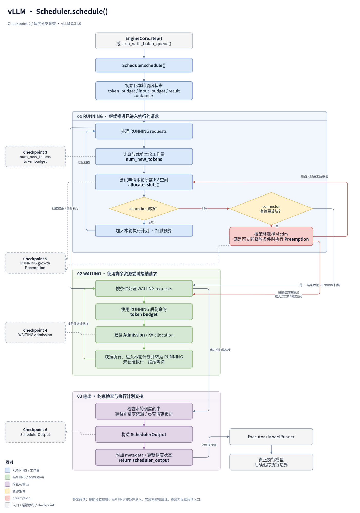
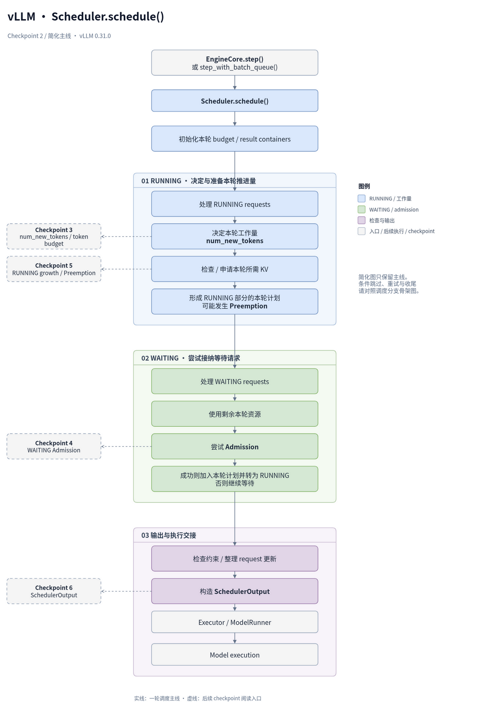
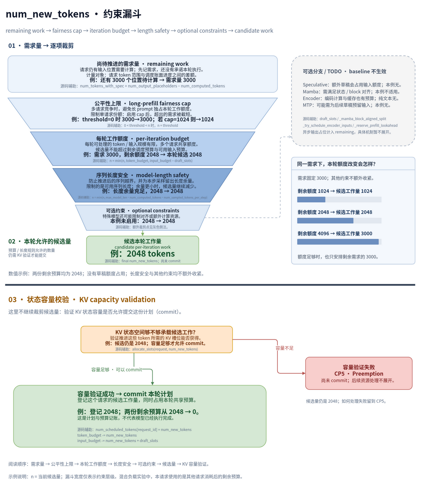
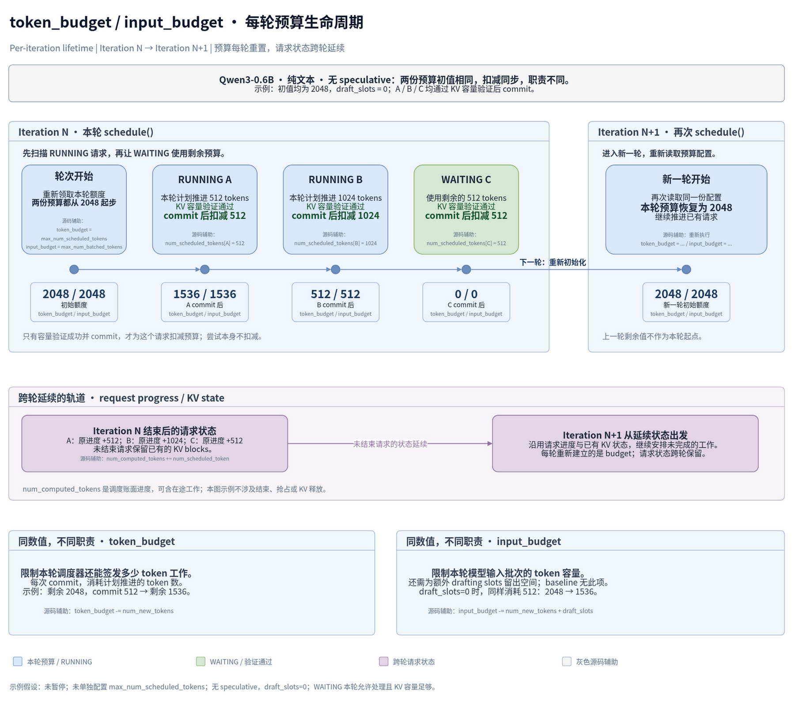
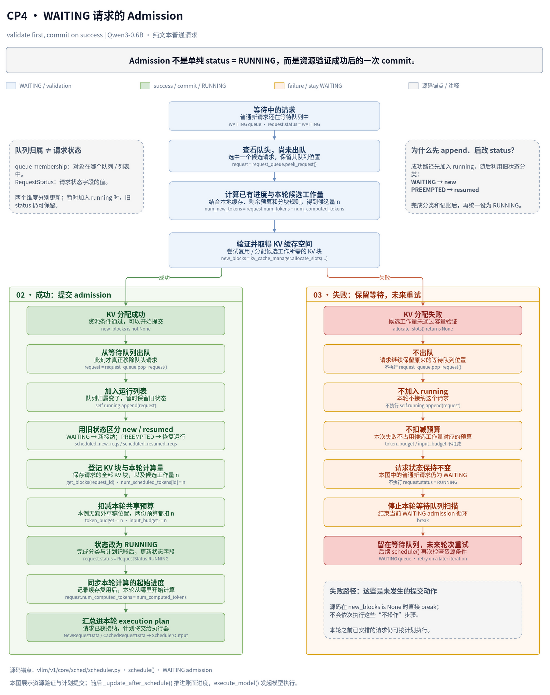

vllm 源码探究
---

# 需要搞懂的问题
1. 一个请求在哪里从“API request”变成 engine 内部的 Request？
2. WAITING 和 RUNNING 到底是谁维护的？
3. Scheduler.schedule() 一轮究竟在算什么？
4. num_new_tokens、token budget 在哪里限制本轮工作量？
5. KV block 的需求在哪里计算，allocate_slots() 返回失败意味着什么？
6. Scheduler 一轮结束以后到底产出什么对象？
7. ModelRunner 拿到这个结果后，如何把它变成真正的 model execution？

# checkpoint1

## 阅读指导

**Checkpoint 1：内部 Request 的创建与进入 waiting**

本次只跟踪一个**普通、新建、非 streaming 的文本生成请求**。下面链接打开 installed source；submodule 中对应 `third_party/vllm/vllm/` 下的同名路径，关键文件内容一致。

先打开 [v1/engine/core.py](/home/boran/PycharmProjects/vllm-playground/.venv/lib/python3.12/site-packages/vllm/v1/engine/core.py)，从 `EngineCore.preprocess_add_request()` 开始。围绕它做以下几个小跳转，都属于同一个 checkpoint：

| 顺序 | 文件 / 类 / 函数 | 本次阅读范围 |
|---|---|---|
| 1 | `core.py` → `EngineCore.preprocess_add_request()` | 看 `Request.from_engine_core_request(...)` 的对象转换与返回值 |
| 2 | [v1/request.py](/home/boran/PycharmProjects/vllm-playground/.venv/lib/python3.12/site-packages/vllm/v1/request.py) → `Request.from_engine_core_request()`、`Request.__init__()` | 看字段传递，以及 `status`、`num_computed_tokens` 的初始化 |
| 3 | `core.py` → `EngineCoreProc.process_input_sockets()`、`_handle_client_request()`、`EngineCore.add_request()` | 只看 ADD 接收、输入队列交接、ADD 分派和交给 scheduler 的调用 |
| 4 | [v1/core/sched/scheduler.py](/home/boran/PycharmProjects/vllm-playground/.venv/lib/python3.12/site-packages/vllm/v1/core/sched/scheduler.py) → `Scheduler.add_request()` | 看是否已有同 ID 请求，再看新请求的 else 分支 |
| 5 | 同一 `scheduler.py` → `_enqueue_waiting_request()` 及两个判断辅助函数 | 看阻塞状态判断、是否持有 KV blocks 的判断；回看 `Scheduler.__init__()` 的容器定义 |

这次阅读只回答三个问题：

1. `EngineCoreRequest` 在哪里变成内部 `Request`？`WAITING` 初始状态由谁设置？
2. `EngineCore.add_request()` 把请求交给谁？新请求最终加入哪个队列，又登记在哪个字典？
3. 这条新请求入队路径有没有调用 `allocate_slots()`，或把请求加入 `self.running`？据此，**进入 waiting 与 admission 是否是同一步？**

与实验的对应：这里先把 **Running / Waiting** 从观测指标对应到实际容器，再辨认 **Continuous Batching** 的请求入口与后续调度的分界。你在 homogeneous concurrency 实验里同时发出的多个请求，可以先逐个套进这条入队路径；它们何时获得 KV 空间、进入 RUNNING，留到后面的 admission checkpoint。

## 探索中的问题与结论

### 1. EngineCoreRequest 是什么，从哪里来？

它是前端交给 EngineCore 的请求数据结构，定义在 `v1/engine/__init__.py`。常规路径由 `InputProcessor.process_inputs()` 构造，携带输入 token、采样参数、请求 ID 等；跨进程时经 EngineCoreClient 编码发送。

以下是 `EngineCoreRequest` 中部分原始字段定义：

```python
request_id: str
prompt_token_ids: list[int] | None
mm_features: list[MultiModalFeatureSpec] | None
sampling_params: SamplingParams | None
pooling_params: PoolingParams | None
arrival_time: float
lora_request: LoRARequest | None
cache_salt: str | None
data_parallel_rank: int | None
```

### 2. 为什么还要转换成内部 Request，是否舍弃字段？

`Request.from_engine_core_request()` 保留执行所需输入，并通过构造函数建立可变执行状态：`status`、输出 token、`num_computed_tokens`、抢占计数等。`data_parallel_rank` 用于 client 路由；`current_wave` 单独返回并传递；`external_req_id` 的映射由前端 OutputProcessor 保存。

以下摘录 `Request.__init__()` 中分散的初始化语句：

```python
self.status = RequestStatus.WAITING
self._output_token_ids: list[int] = []
self.num_computed_tokens = 0
self.num_preemptions = 0
```

生成请求的 `self.max_tokens` 来自 `sampling_params.max_tokens`，限制单个请求的输出长度；它与 scheduler 每轮的 `max_num_batched_tokens` 不同。

### 3. cache_salt 是否说明跨用户复用会串对话？

`cache_salt` 是可选的缓存隔离条件，不同 salt 可以隔离相同前缀，但不会自动识别用户。相同模型及相关计算条件下，共享相同前缀的 KV 本身不会串对话；隔离也可避免跨租户通过命中耗时探测前缀。TODO：后续看 `kv_cache_utils.py` 中缓存 hash 如何加入 salt。

### 4. 状态为什么不只有 WAITING / RUNNING？

`RequestStatus` 还区分等待 grammar、远端 KV、streaming 输入等条件，以及不同结束原因。`PREEMPTED` 单独记录被抢占但尚未结束的请求；`is_finished()` 通过 `status > PREEMPTED` 判断结束。状态与所属队列不是一回事，实验中的 Waiting / Running 是汇总指标。

以下摘录状态枚举成员与结束判断，中间省略其他方法：

```python
WAITING = enum.auto()
WAITING_FOR_STRUCTURED_OUTPUT_GRAMMAR = enum.auto()
WAITING_FOR_REMOTE_KVS = enum.auto()
WAITING_FOR_STREAMING_REQ = enum.auto()
RUNNING = enum.auto()
PREEMPTED = enum.auto()
# Note: anything after PREEMPTED will be considered
# as a finished status.
FINISHED_STOPPED = enum.auto()
FINISHED_LENGTH_CAPPED = enum.auto()
FINISHED_ABORTED = enum.auto()
FINISHED_IGNORED = enum.auto()
FINISHED_ERROR = enum.auto()
FINISHED_REPETITION = enum.auto()
```

```python
@staticmethod
def is_finished(status: "RequestStatus") -> bool:
    return status > RequestStatus.PREEMPTED
```

### 5. process_input_sockets 做什么，如何接上之前的函数？

它是 EngineCore 侧后台输入线程入口。对 ADD：ZMQ 接收 → 解码为 `EngineCoreRequest` → `preprocess_add_request()` → 内部 `Request` → 写入 `input_queue`。ZMQ 是消息通信库，可使用 IPC 或 TCP；这里先把它当作进程间消息通道。

### 6. 谁读取 input_queue，怎么找到调用者？

`_process_input_queue()` 读取消息并调用 `_handle_client_request()`，后者按 ADD / ABORT / UTILITY 等类型分发。ADD 再经 `EngineCore.add_request()` 到 `Scheduler.add_request()`。查调用者可用 PyCharm 的 Find Usages；跨队列衔接时，要同时追写入和读取。

对应的写入语句与非阻塞读取片段分别是：

```python
self.input_queue.put_nowait((request_type, request))
```

```python
while not self.input_queue.empty():
    req = self.input_queue.get_nowait()
    self._handle_client_request(*req)
```

### 7. EngineCore 是多线程的吗，还有输出队列吗？

这里有后台输入线程、engine 主循环和后台输出线程。输入线程写 `input_queue`，主循环处理消息并推进执行、写 `output_queue`，`process_output_sockets()` 读取输出并发送。ABORT 同时写 `aborts_queue` 和 `input_queue`：前者允许尽早处理，后者保留消息顺序；取消处理是幂等的。

### 8. run_busy_loop 的骨架和两段输入处理是什么意思？

外层每轮处理输入消息、发布计数、推进 engine step、再发布计数。输入处理分两段：没有执行工作时阻塞等消息，直到有工作；随后非阻塞地处理已到达消息，队列空了就返回执行。`has_work()` 不等于消息队列非空；第一段也不是只 try 一次。合成一个循环也可实现，两段只是明确不同等待与退出条件。

`EngineCoreProc.run_busy_loop()` 的原始骨架：

```python
@fault_tolerant_wrapper
def run_busy_loop(self):
    """Core busy loop of the EngineCore."""
    while self._handle_shutdown():
        # 1) Poll the input queue until there is work to do.
        self._process_input_queue()
        # Publish request counts before and after GPU step to ensure freshness.
        self._maybe_publish_request_counts()
        # 2) Step the engine core and return the outputs.
        self._process_engine_step()
        self._maybe_publish_request_counts()

    raise SystemExit
```

第一段的循环条件是 `while not self.has_work() and self.is_running()`；其读取片段如下。默认可阻塞等消息，配置为非阻塞时，空队列由 `queue.Empty` 处理；第二段使用上面的 `get_nowait()` 循环。

```python
block = self.process_input_queue_block
try:
    req = self.input_queue.get(block=block)
    self._handle_client_request(*req)
except queue.Empty:
    break
if not block:
    break
```

### 9. KVConnector / ECConnector 与传递参数是什么关系？

两者是可选传输组件：KVConnector 传递 KV cache，例如 prefill / decode 分离；ECConnector 传递 encoder cache，例如多模态编码与后续执行分离。请求中的 transfer params 是传输信息，connector 是处理它的组件；`EngineCore.add_request()` 此处只检查并打印缺少组件的 warning。TODO：具体传输机制暂不深入。

### 10. _enqueue_waiting_request 是不是只入队？

是。受条件阻塞的请求加入 `deferred_waiting` 集合，同时按是否持有 KV blocks 进入 `kv_holding_waiting` 或 `waiting`，两个 if 独立。普通新请求进入 `waiting`，外层还登记到 `self.requests`；此处没有分配 KV，也没有加入 RUNNING，入队与 admission 是不同步骤。

```python
def _enqueue_waiting_request(self, request: Request) -> None:
    if self._is_blocked_waiting_status(request.status):
        self.deferred_waiting.add(request)
    if self._holds_kv_blocks(request):
        self.kv_holding_waiting.add_request(request)
    else:
        self.waiting.add_request(request)
```

# checkpoint2

## 阅读指导

**Checkpoint 2：只看 `schedule()` 的顶层骨架。** 本次用函数名和关键语句定位，不列行数。仍以 installed source 为准；submodule 对应文件一致。

先打开 [v1/engine/core.py](/home/boran/PycharmProjects/vllm-playground/.venv/lib/python3.12/site-packages/vllm/v1/engine/core.py)。

| 函数 | 建议阅读的小范围 | 这一段观察什么 |
|---|---|---|
| `EngineCoreProc._process_engine_step()` | 从函数入口到 `outputs, model_executed = self.step_fn()` | 找到 engine step 实际调用的入口 |
| `EngineCore.__init__()` | 只看 `self.step_fn = (...)` 的赋值 | 确认它可能指向哪两个函数 |
| `EngineCore.step()` | 从函数入口读到 `self.scheduler.schedule(...)`，停止 | 找到普通路径的 scheduler 调用 |
| `EngineCore.step_with_batch_queue()` | 搜索其中的 `self.scheduler.schedule(...)`，只看外围 `if` | 标记另一条调用路径，不读 batch queue 机制 |

然后打开 [v1/core/sched/scheduler.py](/home/boran/PycharmProjects/vllm-playground/.venv/lib/python3.12/site-packages/vllm/v1/core/sched/scheduler.py)，进入 **`Scheduler.schedule()`**。按文件顺序做下面几个小跳转，暂时跳过循环内部的大段逻辑。

| 阅读范围的起止锚点 | 这一段观察什么 |
|---|---|
| 从函数入口，到 `token_budget = self.max_num_scheduled_tokens` 及紧邻的 `input_budget` 初始化 | 看本轮建立了哪些结果容器；标记 budget 的首次赋值 |
| 从注释 `First, schedule the RUNNING requests.`，到循环内 `request = self.running[req_index]` | 看 RUNNING 块的位置、循环条件和读取的容器 |
| 从注释 `Next, schedule the WAITING requests.`，到 `request = request_queue.peek_request()` | 看 WAITING 块的位置、外围条件和读取的容器；与上一块比较顺序 |
| 从注释 `Check if the scheduling constraints are satisfied.`，到这组 `assert` 结束 | 看请求处理之后有哪些顶层检查，只看检查对象 |
| 搜索 `new_reqs_data` 和 `cached_reqs_data` 的赋值，只看赋值及调用参数 | 看输出构造之前准备了哪些数据；不进入辅助函数 |
| 从 `scheduler_output = SchedulerOutput(...)` 到右括号 | 看本轮结果如何封装，先扫字段名 |
| 从注释 `Build the connector meta for ECConnector` 往后，读到 `return scheduler_output` | 看构造后还有哪些收尾调用，以及最终返回的位置；不进入被调用函数 |

另外只放三个书签，**不读机制**：

- **Token budget**：函数开头的 `token_budget = self.max_num_scheduled_tokens`。
- **首次 KV allocation 调用**：RUNNING 块内，注释 `Schedule newly needed KV blocks for the request.` 下的 `self.kv_cache_manager.allocate_slots(...)`。
- **Preemption 分支**：同一块内，注释 `Preempt the lowest-priority request.`；再定位其后的 `self._preempt_request(...)`，不进入函数。

## 探索中的问题与结论

### 调度骨架与后续阅读地图

这里的“输入”主要是 Scheduler 持有或通过管理器访问的状态，不是 `schedule()` 的形参；本轮 token budget 在函数入口初始化。图中保留主骨架与已观察的关键分支，其他辅助分支省略。末尾的模型执行仅标出后续方向。

**详细骨架**（点击图片查看 SVG）

[](diagrams/vllm-scheduler-checkpoint2-detailed.svg)


**简化主线**（点击图片查看 SVG）

[](diagrams/vllm-scheduler-checkpoint2-simplified.svg)

WAITING 的外围条件是 `not preempted_reqs and self._pause_state == PauseState.UNPAUSED`；因此 RUNNING 中发生实际抢占后，本轮会跳过 WAITING。图中的循环箭头表示扫描或重试入口，具体条件留给对应 checkpoint。

| 后续 checkpoint | 深入内容 |
|---|---|
| Checkpoint 3 | `num_new_tokens` 与本轮 token budget 的计算、裁剪 |
| Checkpoint 4 | WAITING admission 与 KV allocation |
| Checkpoint 5 | RUNNING growth、allocation 失败与 preemption |
| Checkpoint 6 | `SchedulerOutput` 的具体字段与交接接口 |

### 1. step 与 step_with_batch_queue 是否一个等结果，一个直接返回？

`EngineCoreProc._process_engine_step()` 调用 `step_fn()`；具体路径在 `EngineCore.__init__()` 中选择：

```python
self.step_fn = (
    self.step if self.batch_queue is None else self.step_with_batch_queue
)
```

两条路径都会调用 scheduler。`step()` 提交本轮 batch 后通过 `future.result()` 等结果；batch queue 路径满足条件时先返回主循环，之后仍会取出较早提交的 batch 并等结果。这里的提交单位是一轮 batch，返回也不是向 API 用户返回整个请求的完成结果。TODO：batch queue 机制。

### 2. _should_throttle_prefills 是否影响本轮 prefill？

它向 `schedule()` 传入一个可选的 prefill 节奏控制开关。普通 `EngineCore` 的实现如下，DP 版本则重写判断；返回 True 也不代表必然禁止所有 prefill，scheduler 还会结合其他条件。

```python
def _should_throttle_prefills(self) -> bool:
    """Whether to defer new prefills this step (DP prefill balancing).
    Overridden by the DP engine core; never throttles otherwise."""
    return False
```

TODO：DP prefill 节奏控制的具体条件。

### 3. RUNNING 和 WAITING 的处理顺序，以及预算是否共享？

RUNNING 先处理，WAITING 后处理；WAITING 使用同一轮剩余的 `token_budget`，没有重新获得一份预算。以下分别摘录两块的循环入口，以及 RUNNING 中扣减预算的语句：

```python
while req_index < len(self.running) and token_budget > 0:
```

```python
token_budget -= num_new_tokens
```

```python
while token_budget > 0:
```

这对应 Mixed Prefill–Decode interference / token budget 实验中的工作量竞争，但不能把顺序直接理解为 decode 先、prefill 后：RUNNING 也可能包含未完成的 chunked prefill。

### 4. 为什么 num_new_tokens 随限制不断减少？

已经观察到它会受到多种条件裁剪，然后用于申请本轮 KV 空间。它表示本轮计划为请求计算的 token 数，可包含 prefill 工作，并不专指新生成的输出 token。

```python
new_blocks = self.kv_cache_manager.allocate_slots(
    request,
    num_new_tokens,
    num_lookahead_tokens=self.num_lookahead_tokens,
)
```

TODO：初始工作量如何计算、各项预算如何裁剪；本次没有深入这些规则。

### 5. allocation 失败后，是否立即抢占某个请求？

已定位 RUNNING 中的失败分支：成功则退出分配循环；失败但 connector 有 pending block frees 时也先退出；否则继续选择 victim。以下代码只是选择候选，真正执行抢占在后面的 `_preempt_request()`：

```python
if self.policy == SchedulingPolicy.PRIORITY:
    preempted_req = max(
        self.running,
        key=lambda r: (r.priority, r.arrival_time),
    )
else:
    preempted_req = self.running[-1]
```

TODO：抢占如何改变状态、释放空间和重新入队。

### 6. 已在 RUNNING，是否意味着资源已经分配完成？

不意味着整个生命周期的 KV 空间已经提前分配。请求通常持有已有 blocks，后续逐轮、逐请求按需增长；容量够时不必新增 block，也不是每轮重新分配全部空间。申请空间的请求与 victim 可以不同，某个请求本轮尚未被遍历也可能成为 victim。

因此，RUNNING 不保证本轮一定执行，已有 KV blocks 也不保证后续增长有空间。这个结论限定于 KV 空间；其他资源各有管理方式。TODO：RUNNING growth 与 preemption 的具体机制。

### 7. 调度后的 assert 在检查什么？

以下是 `Scheduler.schedule()` 中的一组原始检查：

```python
total_num_scheduled_tokens = sum(num_scheduled_tokens.values())
assert total_num_scheduled_tokens <= self.max_num_scheduled_tokens

assert token_budget >= 0
assert input_budget >= 0
assert len(self.running) <= self.max_num_running_reqs
```

它们检查本轮总 token 数不超上限、两份剩余预算不为负，以及 RUNNING 请求数量不超上限。这是验证前面的调度结果，不是在这里才裁剪工作量；RUNNING 数量也不等于本轮安排计算的请求数量。TODO：`input_budget` 与 `token_budget` 的具体区别。

### 8. 新请求 / cached 请求数据是什么，构造 SchedulerOutput 后还有什么？

`new_reqs_data` 提供建立请求执行状态所需的信息，`cached_reqs_data` 为执行侧已有请求传递更新，也包含恢复请求；这里的 cached 不代表命中 prefix KV cache。构造输出就是将这些数据与本轮计划一起传参封装，以下摘录构造参数：

```python
scheduled_new_reqs=new_reqs_data,
scheduled_cached_reqs=cached_reqs_data,
num_scheduled_tokens=num_scheduled_tokens,
total_num_scheduled_tokens=total_num_scheduled_tokens,
```

附加 metadata 等处理之后，末尾更新调度状态并返回；返回值由 engine 的 `scheduler_output` 接住。

```python
with record_function_or_nullcontext("schedule: update_after_schedule"):
    self._update_after_schedule(scheduler_output)
return scheduler_output
```

TODO：输出字段的具体用途、状态更新，以及如何交给 ModelRunner。

### 9. 函数太长，如何梳理才有收获？

本次只沿“初始化 → RUNNING → WAITING → 检查与数据准备 → 构造输出 → 收尾返回”识别边界。WAITING 入口缩小为“外围条件 → 循环入口 → 选队列 → 取请求”；比较两块共享预算的关系，比只认函数位置更有意义。

当前最重要的三个认识：RUNNING 不等于本轮一定执行；WAITING 使用剩余预算；`schedule()` 产出本轮执行计划。具体的 token 计算、admission、preemption 和 KVCacheManager 内部留到后续 checkpoints。

# checkpoint3

## 阅读指导
**Checkpoint 3：只沿 `num_new_tokens` 的赋值和使用追踪，预计 20–30 分钟。** Installed 与 submodule 的 `scheduler.py` 仍一致。以下链接指向 installed source，不列行数。

主要文件是 [v1/core/sched/scheduler.py](/home/boran/PycharmProjects/vllm-playground/.venv/lib/python3.12/site-packages/vllm/v1/core/sched/scheduler.py)，函数为 **`Scheduler.schedule()`**。

| 顺序 | 最小阅读范围 / 锚点 | 这里观察什么 |
|---|---|---|
| 1 | 函数开头，只找 `token_budget = self.max_num_scheduled_tokens` 和 `input_budget = ...`；再找 `long_prefill_token_threshold = (...)` | 先认出后面裁剪会用到的预算与阈值。需要确认预算配置来源时，只跳到 `Scheduler.__init__()` 中 `self.max_num_scheduled_tokens` 的赋值 |
| 2 | RUNNING 块中第一次 `num_new_tokens = (...)`，只读这一个表达式 | 比较“请求已有的 token 范围”与“已安排计算的进度”，观察初始差额的语义 |
| 3 | 紧接着的 `if 0 < long_prefill_token_threshold < num_new_tokens:` 及赋值 | 观察这个阈值在什么条件下替换初值。先前的 adaptive threshold 配置分支标作 TODO |
| 4 | 紧接着的 `num_new_tokens = min(num_new_tokens, token_budget, input_budget - draft_slots)` | 观察单请求候选工作量如何受到**本轮剩余预算**限制；无 speculative decoding 时先按 `draft_slots == 0` 阅读 |
| 5 | 注释 `Make sure the input position does not exceed the max model len.` 下的第二个 `min(...)` | 观察模型长度的剩余空间如何成为另一项上限；不展开 speculative decoding 的原因 |
| 6 | 跳过特殊分支，找到 `if num_new_tokens == 0:`，只看 `req_index += 1`、`continue`；再找到 `allocate_slots(...)` 的调用参数 | 观察裁剪为零后如何停止当前请求的尝试，以及非零候选值在哪里交给 KV 分配接口 |
| 7 | 跳过分配循环内部，搜索注释 `Schedule the request.`，只读到两项 budget 扣减 | 观察成功后，哪个值被登记为本轮工作量、如何扣减共享预算 |

第二步只需额外打开 [v1/request.py](/home/boran/PycharmProjects/vllm-playground/.venv/lib/python3.12/site-packages/vllm/v1/request.py)，看 **`Request.num_tokens`、`Request.num_tokens_with_spec`** 两个短属性；不重新读构造函数。初值表达式中的 speculative token 和异步输出占位项先标为 **可选分支 / TODO**。

第五步之后，这三处也会接触或修改该变量，但此次只留下书签：

- `_mamba_block_aligned_split(...)`：**Mamba 对齐分支 / TODO**。
- `_try_schedule_encoder_inputs(...)`：**多模态 / encoder 分支 / TODO**。
- `_reserve_prefill_lookahead(...)`：**multi-module MTP 分支 / TODO**。

Connector、DP prefill throttling、structured output 等判断也跳过。

**Chunked Prefill 的观察点就在第三、第四步。** 取一个 prompt 尚未算完的 RUNNING 请求，手算一次：剩余 prompt 工作量为 `1000`，本轮剩余预算为 `128`；暂设其他上限不收紧。观察它经过这些赋值后，是否必须一次安排完整剩余 prompt。

第七步的停止位置是：

```python
num_scheduled_tokens[request_id] = num_new_tokens
token_budget -= num_new_tokens
input_budget -= num_new_tokens + draft_slots
```

读到这里就停，不进入 preemption 或 WAITING。

## 探索中的问题与结论

### 1. num_new_tokens如何变化？

| 顺序 | 代码表达式 | 生效条件 | 语义 | 普通主路径是否相关 |
|---|---|---|---|---|
| 1 | `num_new_tokens = request.num_tokens_with_spec + request.num_output_placeholders - request.num_computed_tokens` | 当前请求通过前置检查 | 请求的目标 token 范围减去调度账面进度，得到理论待计算量。`num_tokens_with_spec` 包含 prompt、已回传输出和 speculative tokens；placeholder 补充尚未回传的预期输出 | **相关**；无 spec 时 speculative 项为空，异步占位项另标 TODO |
| 2 | `num_new_tokens = long_prefill_token_threshold` | `0 < long_prefill_token_threshold < num_new_tokens`；有效阈值还要求不止一个请求竞争 | 用单请求阈值裁剪候选工作量 | 可选配置；**之前实验阈值为 0，不生效** |
| 3 | `num_new_tokens = min(num_new_tokens, token_budget, input_budget - draft_slots)` | 无条件执行；预算不足时才收紧 | 同时受本轮剩余调度预算和模型输入容量限制；未完成 prefill 可在这里被截为本轮的一部分 | **相关**；无 spec 时 `draft_slots = 0` |
| 4 | `num_new_tokens = min(num_new_tokens, self.max_model_len - request.num_computed_tokens - self.num_sampled_tokens_per_step)` | 无条件执行；接近模型长度边界时收紧 | 限制推进后的输入位置，保留每步采样所需的余量 | **相关**，普通自回归生成也经过此处 |
| 5 | `num_new_tokens = self._mamba_block_aligned_split(request, num_new_tokens)` | `self.need_mamba_block_aligned_split` | 接受 Mamba 对齐规则返回的工作量 | **Mamba 可选分支 / TODO**；Qwen3-0.6B 不走 |
| 6 | 元组赋值中的 `num_new_tokens`，来自 `self._try_schedule_encoder_inputs(...)` | `request.has_encoder_inputs` | 接受 encoder 调度返回的工作量，可能进一步裁剪 | **多模态 / encoder 可选分支 / TODO**；纯文本不走 |
| 7 | `num_new_tokens = self._reserve_prefill_lookahead(request, request.num_computed_tokens, num_new_tokens)` | 调用无条件；特殊 prefill lookahead 约束可能改变返回值 | 接受预留规则返回的工作量 | **MTP 可选约束 / TODO**；之前无 spec 的实验不收紧它 |
| 8 | `if num_new_tokens == 0: ... continue` | 裁剪结果为零 | 不再尝试为当前请求安排本轮工作；**不修改变量** | **相关的出口** |
| 9 | `self.kv_cache_manager.allocate_slots(request, num_new_tokens, num_lookahead_tokens=self.num_lookahead_tokens)` | 候选值非零并到达分配位置 | 把最终候选工作量交给 KV 分配接口；**此调用处不重新赋值该变量** | **相关**；不进入内部 |
| 10 | `num_scheduled_tokens[request_id] = num_new_tokens`；`token_budget -= num_new_tokens`；`input_budget -= num_new_tokens + draft_slots` | KV 分配成功，并到达成功调度块 | 登记本轮请求工作量，扣减两份共享预算 | **相关**；无 spec 时两份预算都扣同一个数 |

### 2. 从剩余需求到本轮候选工作量：约束漏斗

**num_new_tokens 约束漏斗**（点击图片查看 SVG）

[](diagrams/vllm-num-new-tokens-constraint-funnel.svg)

请求的理论剩余工作依次受到公平性上限、本轮预算、模型长度安全与可选约束的限制，得到本轮候选量。示例中 remaining=3000、threshold=0、剩余 budget=2048，其他约束不收紧，因此候选量为 2048。随后 KV capacity validation 验证状态空间是否允许 commit，不继续裁剪这个数；成功后才登记本轮计划并扣减预算，失败处理留到 CP5。

### 3. 本轮预算与跨轮状态：两轮时间轴

**token_budget / input_budget 的 per-iteration 生命周期**（点击图片查看 SVG）

[](diagrams/vllm-budget-per-iteration-lifecycle.svg)

每次 `schedule()` 开始都重新初始化预算。示例中 RUNNING A、B 成功 commit 后，预算从 2048 依次降到 1536、512；WAITING C 使用剩余 512，commit 后降到 0。下一轮预算重新从 2048 开始，未结束请求的进度与已有 KV 状态延续。在当前无 speculative、未单独配置调度预算的 baseline 下，`draft_slots=0`，两份预算初值与扣减同步；`token_budget` 限制调度签发量，`input_budget` 限制模型输入批次容量。

# checkpoint4

## 探索中的问题与结论

本次只追踪 Qwen3-0.6B、纯文本、无 speculative 的普通新请求：进入时状态为 `WAITING`，尚未持有 KV blocks。依据 installed vLLM 0.31.0 的 [v1/core/sched/scheduler.py](/home/boran/PycharmProjects/vllm-playground/.venv/lib/python3.12/site-packages/vllm/v1/core/sched/scheduler.py)，函数为 `Scheduler.schedule()`；不展开 KVCacheManager 内部。

### 1. 普通 WAITING 请求的 admission 路径是什么？

| 顺序 | 代码表达式 / 锚点 | 生效条件 | 语义 |
|---|---|---|---|
| 1 | `if not preempted_reqs and self._pause_state == PauseState.UNPAUSED:` | 本轮没有实际抢占，scheduler 未暂停 | 允许进入 WAITING 调度阶段 |
| 2 | `while token_budget > 0`；`input_budget <= draft_slots`；`num_running >= self.max_num_active_reqs` | 仍有两种预算和 active request 名额 | WAITING 使用 RUNNING 之后剩余的预算；条件不足时结束扫描。无 spec 时 `draft_slots=0`，普通非 streaming 路径的 `num_running` 是 `len(self.running)` |
| 3 | `request_queue = self.kv_holding_waiting or self.waiting`；`request_queue.peek_request()` | 队列非空 | 持有 KV 的等待请求优先；本次普通新请求在 `self.waiting`。这里只查看队首，尚未出队 |
| 4 | `_get_local_prefix_cache_hit(request)`；`num_new_tokens = request.num_tokens - num_computed_tokens` | 新请求的 `request.num_computed_tokens == 0` | 查询可复用的本地前缀，扣除缓存命中对应的进度，得到待计算量；无 connector 时外部命中数为 0 |
| 5 | `request_token_budget = min(token_budget, input_budget - draft_slots)`；long-prefill cap；`num_new_tokens = min(num_new_tokens, request_token_budget)` | 到达普通本地 prefill 路径 | 得到本轮候选工作量。开启 Chunked Prefill 可只安排部分 prompt；关闭时，工作量超出剩余预算则 `break` |
| 6 | `num_tokens_past_hit = max(num_new_tokens - num_replay_tokens, 0)`；`allocate_slots(...)` | 候选量非零 | 验证 KV 容量并尝试取得所需 blocks；本次无 replay，传入工作量等于 `num_new_tokens`。同时传入命中的本地 blocks 和 `full_sequence_must_fit` 等接口参数 |
| 7 | `if new_blocks is None: ... break` | allocation 失败 | 请求没有出队，不进入本轮计划，不扣减预算；结束本轮 WAITING 扫描 |
| 8 | `pop_request()` → `self.running.append(request)` → `scheduled_new_reqs.append(request)` → 登记计划、扣预算、设为 `RUNNING` | allocation 成功，普通新请求仍为 `WAITING` | 正式接纳请求，并安排它在本轮执行 |

`full_sequence_must_fit=self.scheduler_reserve_full_isl` 值得单独记住：该版本配置默认 `scheduler_reserve_full_isl=True`，admission 会检查完整输入序列是否能容纳于 KV cache，而不只看第一个 chunk。这是容量检查，不能理解为本轮要计算完整 prompt，也不能仅凭这个开关判断实际分配了多少块；内部实现留待后续。

### 2. 先验证资源，成功后提交 admission

**WAITING admission：validate → commit**（点击图片查看 SVG）

[](diagrams/vllm-waiting-admission-validate-commit.svg)

图中成功侧是 allocation 通过之后发生的队列、计划和状态更新；“commit”是对这组操作的概念命名，不是源码中的独立事务函数。失败侧列出的是未发生的成功操作，不是代码逐项执行“不操作”。容量不足直接 `break`，本轮此前已安排的其他请求仍保留在执行计划中。

### 3. 哪里说明被 admission 了？为什么先 append，后改 status？

allocation 成功是资源条件，以下操作才把接纳结果落实到调度状态。原始代码摘录：

```python
request = request_queue.pop_request()
self.deferred_waiting.discard(request)
self.running.append(request)
```

请求离开等待队列，清除可能存在的 deferred 标记，再加入运行列表。`discard()` 在集合里没有这个请求时也不会报错。队列归属与 `Request.status` 是两个分别更新的维度：此时已加入 `running`，但旧状态暂时保留，便于分类。

```python
if request.status == RequestStatus.WAITING:
    scheduled_new_reqs.append(request)
elif request.status == RequestStatus.PREEMPTED:
    scheduled_resumed_reqs.append(request)
else:
    raise RuntimeError(f"Invalid request status: {request.status}")
```

本次普通新请求走 `WAITING → scheduled_new_reqs`；`PREEMPTED → scheduled_resumed_reqs` 只记录接口，恢复机制留到 CP5。分类和计划记账后，才统一设为 `RUNNING`。同步外部 KV 加载标记属于 connector TODO；`record_event(SCHEDULED, ...)` 是统计事件。

### 4. 成功后登记了什么？进度是否已经加上本轮工作量？

```python
req_to_new_blocks[request_id] = self.kv_cache_manager.get_blocks(
    request_id
)
num_scheduled_tokens[request_id] = num_new_tokens
token_budget -= num_new_tokens
input_budget -= num_new_tokens + draft_slots
request.status = RequestStatus.RUNNING
request.num_computed_tokens = num_computed_tokens
```

登记请求当前的 KV blocks 和本轮 token 数；这里的 `get_blocks()` 不能简单理解为“只取本轮新分配的块”。预算在 allocation 成功、请求出队后才扣减；本次 `draft_slots=0`，两份预算扣同一个数。

这里写入的 `num_computed_tokens` 是本轮计算的起点，包括可复用缓存命中，尚未加上本轮安排量。例如 prompt=3000、命中=1024、本轮安排=512：此处进度记为 1024，计划表记为 512。`schedule()` 尾部 `_update_after_schedule()` 才把安排量加到调度账面进度中；这仍不代表 GPU 已完成计算。

### 5. 新接纳的请求是否要等下一轮？与 RUNNING 如何共同打包？

不用等下一轮：WAITING 分支本身就能登记本轮工作，不需要再经过已经扫描完的 RUNNING 分支。若 chunked prefill 尚有剩余，剩余部分下一轮再按 RUNNING 路径推进。

| 本轮请求来源 | 调度时登记到 | 输出字段 |
|---|---|---|
| 从 WAITING 接纳的普通新请求 | `scheduled_new_reqs` | `scheduled_new_reqs=new_reqs_data` |
| 本轮安排的已有 RUNNING 请求 | `scheduled_running_reqs` | `scheduled_cached_reqs=cached_reqs_data` |

新请求通过 `NewRequestData.from_request(...)` 准备执行端建立状态所需的数据；已有请求通过 `_make_cached_request_data(...)` 准备更新。cached 指执行端已有请求状态，不是 prefix cache 命中。两条路径共用 `num_scheduled_tokens`，最终进入同一份本轮输出：

```python
scheduler_output = SchedulerOutput(
    scheduled_new_reqs=new_reqs_data,
    scheduled_cached_reqs=cached_reqs_data,
    num_scheduled_tokens=num_scheduled_tokens,
    # 其他字段省略
)
```

此时产生的是执行计划，后续 Executor / ModelRunner 才执行模型；具体输出字段留到 CP6。

### 6. 失败后为什么继续 WAITING？

纯文本 allocation 失败路径跳过 encoder 清理，核心是：

```python
if new_blocks is None:
    # The request cannot be scheduled.
    # 此处 encoder 清理分支省略
    break
```

前面只有 `peek_request()`，后面的 `pop_request()`、加入 running、计划登记、预算扣减和状态转换都未执行。因此请求留在原等待队列，状态仍为 `WAITING`。不是失败后重新赋值 WAITING，而是没有走到状态转换。

这个 `break` 退出本轮整个 WAITING 扫描，不继续尝试后面的等待请求。预算或 active request 名额不足也会更早退出。下一轮重新检查资源条件，可能再次尝试；本次不把 WAITING allocation 失败展开成 RUNNING victim / preemption 路径。

### 7. 滑动窗口 KV 是否需要在 CP4 深入？

沿途的 `SWA bounded replay` 属于 Sliding Window Attention 的缓存恢复处理，本次 Qwen3-0.6B baseline 跳过，`num_replay_tokens=0`。它与 prefix cache、Chunked Prefill 是不同维度：滑动窗口决定注意力需要哪些历史 KV；prefix cache 复用已计算的相同前缀；Chunked Prefill 决定本轮计算多少 prompt token。

TODO：特殊 WAITING 状态、streaming / stale output、connector、LoRA、多模态 / encoder、structured output、speculative / MTP、Mamba、SWA replay、DP prefill cadence。CP4 只保留“等待队列中的请求 → 候选工作量 → KV 容量验证 → 成功接纳并进入本轮计划 / 失败继续等待”。
