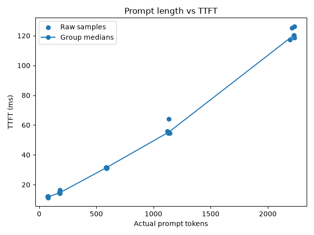
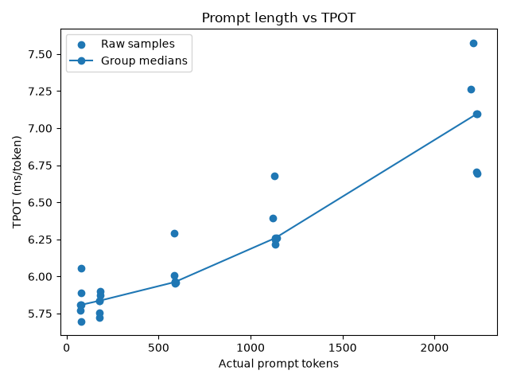
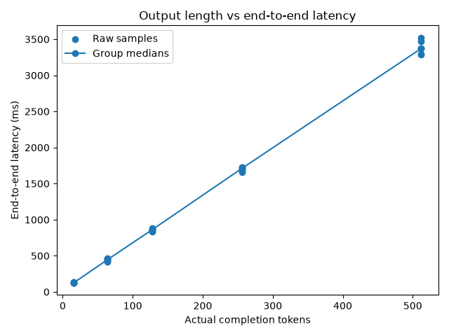
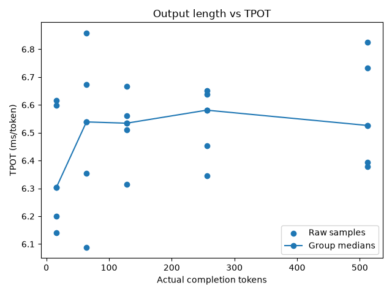
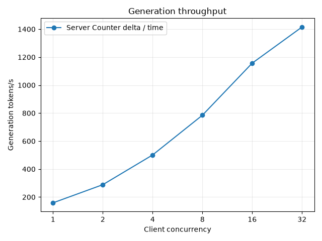
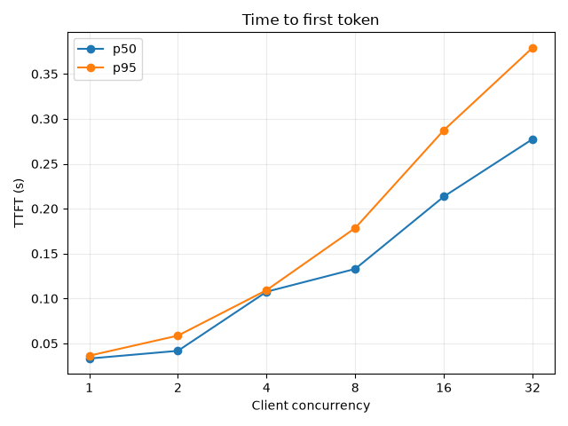
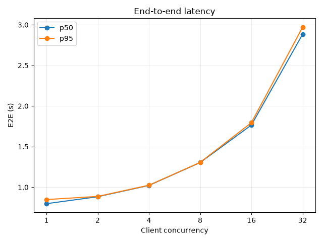
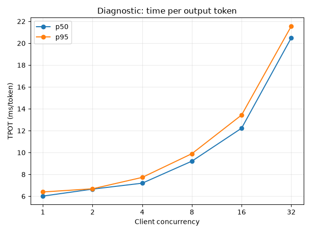
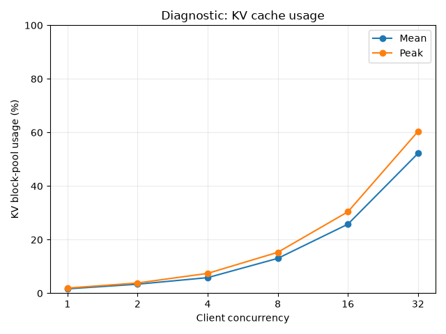
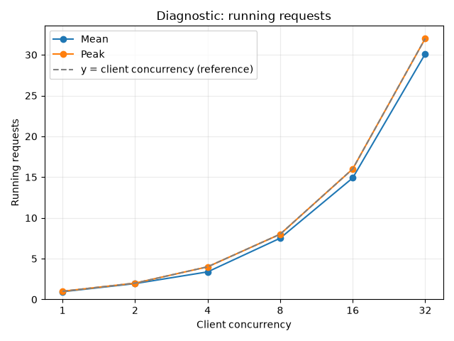

# Week 1 experiments

Selected result figures are preserved in `pics/` with descriptive names and embedded
below. Each section identifies its source run; original CSV/PNG outputs remain in
gitignored `results/`. These copies let the notes retain their figures in Git.

## Prompt length

**Question:** How does prompt/context length affect TTFT and decode performance?

**Controlled:** Qwen/Qwen3-0.6B, concurrency 1, maximum output 64 tokens.

**Variable:** Prompt length.

**Method:** Five repetitions per size, randomized order, unique per-request prefix, one uncounted warmup; medians reduce sensitivity to individual outliers.

**Illustrated run:** `20261006-222435`, from `results/prompt_length-20261006-222435.csv`. This is the only archived prompt-length run available in `results/`: all five sizes have five complete samples, with 64 output tokens and finish reason `length` throughout. The summary below uses this CSV so its numbers and figures refer to the same run.

**Observed in the illustrated run:** Median actual prompt lengths were approximately 77, 180, 588, 1135, and 2229 tokens. Median TTFT was 11.8, 14.6, 31.4, 55.3, and 120.4 ms. Median decode throughput was 172.182, 171.345, 167.733, 159.760, and 140.928 tokens/s.

**Interpretation:** Longer prompts add Prefill work and strongly increase TTFT. Decode also slows somewhat because each new query attends over more historical KV. In this workload, TTFT is much more sensitive to prompt length than TPOT.

**Figures:** Raw samples and group medians from the illustrated run.

**Caveats:** These are client-observed measurements over localhost, on one RTX 4060 Laptop GPU, with the small Qwen3-0.6B model. This is an educational experiment, not a hardware benchmark score.

## Output length

**Question:** How does output length affect E2E latency and Decode performance when prompt workload is approximately fixed?

**Controlled:**

- model = Qwen/Qwen3-0.6B
- concurrency = 1
- fixed prompt body; actual prompt ≈ 577 tokens

**Variable:** Output length / max_tokens.

**Method:**

- 5 repetitions
- randomized order
- unique early request prefix
- fixed base prompt body
- one uncounted warmup
- medians

**Illustrated run:** `20261006-225619`, from `results/output_length-20261006-225619.csv`. Three archived output-length runs were checked; all have five complete samples at each of the five output limits and finish reason `length` throughout. The latest complete run is used for both figures, retaining all 25 samples rather than selecting individual points or combining runs.

**Results:** Tested output limits of 16, 64, 128, 256, and 512 tokens; actual outputs reached each limit. In the illustrated run, actual prompt lengths stayed clustered around 574–581 tokens. TTFT medians remained approximately constant at 32.5–34.7 ms. E2E latency increased approximately linearly with generated length. Client-observed TPOT medians were approximately 6.3–6.6 ms/token, with visible raw variation. The earlier runs also show variation and occasional outliers, particularly for shorter outputs.

**Interpretation:** Longer outputs mainly add Decode steps and increase total E2E latency. Current data does not support a strong monotonic increase in TPOT with output length.

**Figures:** Raw samples and group medians from the illustrated run.

**Caveats:** Client-observed measurements over localhost with Qwen/Qwen3-0.6B on a single RTX 4060 Laptop GPU.

## Concurrency

**Question:** Under a fixed homogeneous workload, how does client concurrency affect aggregate generation throughput, TTFT / E2E latency, engine Running / Waiting, and the KV-cache working set? Where do throughput gains begin to diminish?

**Controlled:**

- Fedora, Python 3.12, vLLM 0.31.0, one RTX 4060 Laptop GPU (~8 GB VRAM).
- Qwen/Qwen3-0.6B, `--gpu-memory-utilization 0.75`, `--max-model-len 4096`; other scheduler/batching settings kept at the baseline.
- Fixed instruction and body reused from the output-length experiment, with a unique UUID at the beginning of every request.
- `temperature=0`, `max_tokens=128`, streaming requests over localhost; Prefix Cache remained enabled.

**Variable:** Client concurrency = 1, 2, 4, 8, 16, 32, tested in ascending order.

**Method:** One closed-loop sweep: three excluded global warmup requests, then approximately 2*C warmup completions per level. Each completed request was immediately replaced to maintain approximately C in flight; warmup transitioned continuously into measurement. Collected exactly 128 latency samples per level whose request starts were at or after t0. After the cutoff, stopped replenishing, took t1, drained remaining requests, and waited for Running=Waiting=0 before advancing. See [the formal protocol](concurrency-experiment.md).

Generation throughput uses server Counter deltas divided by the t0/t1 observation interval. Server-window work includes boundary-crossing requests and is a different population from the 128 client samples. Gauges were sampled approximately every 0.2 s, with arithmetic sample mean and peak. Client TTFT ends at the first non-empty content chunk; E2E ends after consuming the full stream; TPOT divides the post-first-content duration by completion_tokens-1. Latency p50/p95 use nearest rank.

**Run:** `20261010-231439-7f9be14b`, 2026-10-10, local time Asia/Shanghai. Source files: `results/concurrency-20261010-231439-7f9be14b-{requests,levels,metrics}.csv` (generated files remain gitignored). The earlier C=1/2, four-sample smoke test was only an integration check and is excluded from these findings.

**Results:** All six levels collected 128 valid samples, 768 total. Actual prompt-token medians were 577 at every level, with an overall range of 570–581. Every measured response generated 128 tokens and finished with `length`. All levels recorded zero local-cache-hit tokens, external-transfer tokens, and preemptions; logical prompt-token deltas matched local-compute deltas.

| Concurrency | Generation tokens/s | TTFT p50 / p95 (ms) | E2E p50 / p95 (s) | TPOT p50 / p95 (ms/token) |
|---:|---:|---:|---:|---:|
| 1 | 158.7 | 33.2 / 36.4 | 0.797 / 0.848 | 6.02 / 6.39 |
| 2 | 288.5 | 41.8 / 58.7 | 0.883 / 0.887 | 6.65 / 6.68 |
| 4 | 500.8 | 107.5 / 109.3 | 1.022 / 1.024 | 7.20 / 7.73 |
| 8 | 784.9 | 132.9 / 178.5 | 1.304 / 1.306 | 9.21 / 9.90 |
| 16 | 1157.0 | 213.5 / 287.4 | 1.765 / 1.795 | 12.23 / 13.43 |
| 32 | 1415.2 | 277.4 / 379.1 | 2.884 / 2.971 | 20.49 / 21.56 |

| Concurrency | Running mean / peak | Waiting mean / peak | KV block-pool usage mean / peak (%) |
|---:|---:|---:|---:|
| 1 | 0.95 / 1 | 0 / 0 | 1.66 / 1.94 |
| 2 | 1.94 / 2 | 0 / 0 | 3.39 / 3.84 |
| 4 | 3.38 / 4 | 0 / 0 | 5.84 / 7.43 |
| 8 | 7.51 / 8 | 0 / 0 | 13.03 / 15.29 |
| 16 | 14.90 / 16 | 0.013 / 1 | 25.78 / 30.41 |
| 32 | 30.11 / 32 | 0 / 0 | 52.21 / 60.39 |

The sole sampled Waiting=1 observation occurred at C=16 with reason `capacity`; deferred waiting stayed zero. This reason alone does not establish KV exhaustion. Running is not GPU batch size, and KV usage describes the vLLM block pool, not total GPU VRAM.

**Interpretation:** Increasing concurrency raised aggregate generation throughput while slowing individual requests. For successive concurrency doublings, throughput gains decreased from 81.7% to 73.6%, 56.7%, 47.4%, and 22.3%. From C=16 to 32, throughput increased 22.3%, but E2E p50 increased 63.4% and TPOT p50 increased 67.6%; Decode slowdown is an important part of the additional latency cost.

The 16–32 range is a candidate region of diminishing returns under this workload, not a proven exact saturation point: throughput still increased at C=32. Running and KV usage increased, but sampled Waiting showed no sustained backlog and no preemption was recorded. The data does not establish KV-capacity exhaustion or identify a specific GPU bottleneck. E2E p95 generally remained close to p50, suggesting broad request slowdown rather than a pronounced extreme tail in this run.

**Plots:** Generation throughput, TTFT p50/p95, and E2E p50/p95 are the original primary plots. TPOT p50/p95, KV usage mean/peak, and Running mean/peak with a client-concurrency reference line were added post hoc as diagnostic / learning plots, using the same recorded levels CSV without new inference or independent evidence.

All six figures below use the formal run `20261010-231439-7f9be14b` identified above.

**Primary plots:**

**Post-hoc diagnostic / learning plots:**

**Caveats:** One ascending sweep on one machine, with no repeated runs or confidence intervals. GPU temperature, frequency, power, and background activity were not strictly controlled; no formal GPU profiling was collected. Measurement windows ranged from about 104 s at C=1 to 14.5 s at C=32. The 128 requests share runtime/scheduling conditions and are not 128 independent replications. Gauge sampling can miss brief waits/peaks, and snapshot timing/exporter refresh introduce boundary uncertainty. Fixed-concurrency closed-loop traffic does not establish behavior under a fixed external arrival rate. Findings apply to this model, workload, baseline configuration, and hardware.
