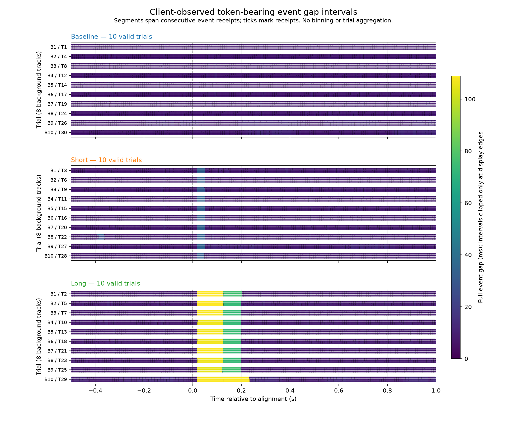
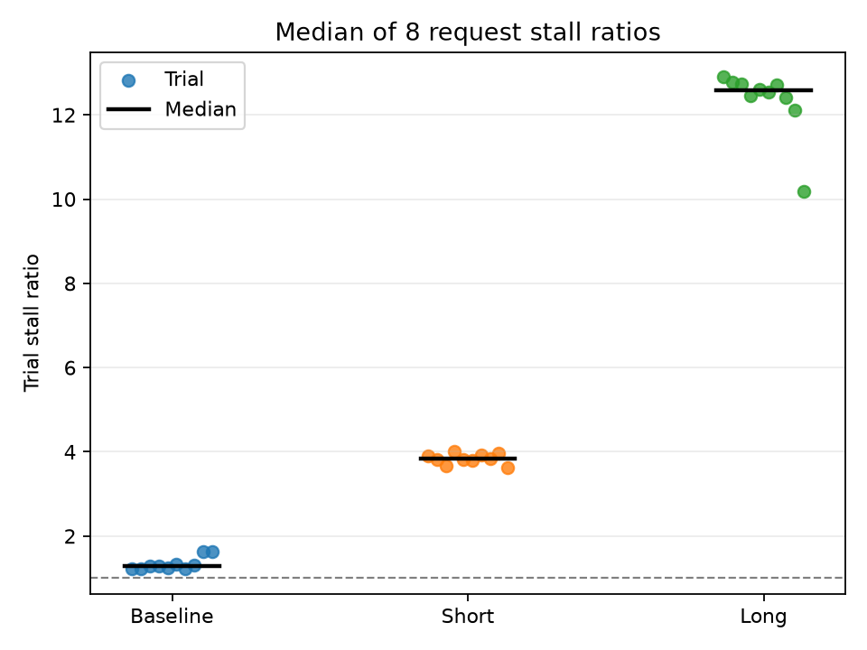
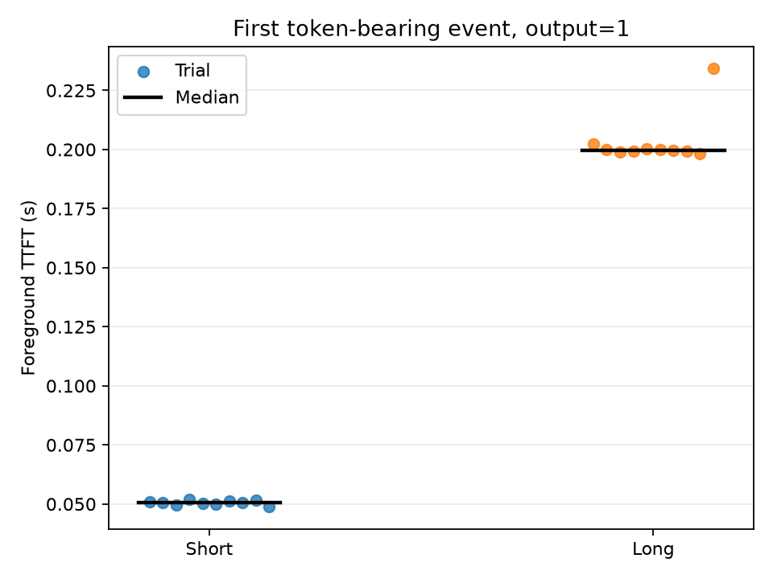
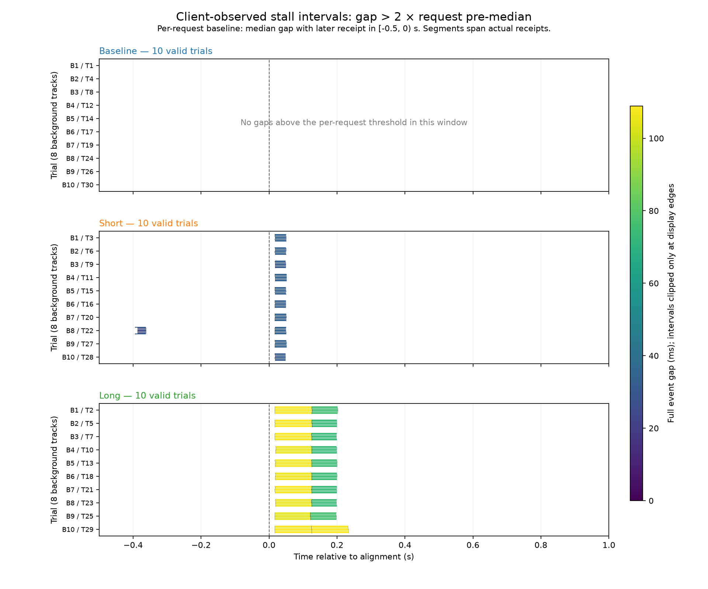
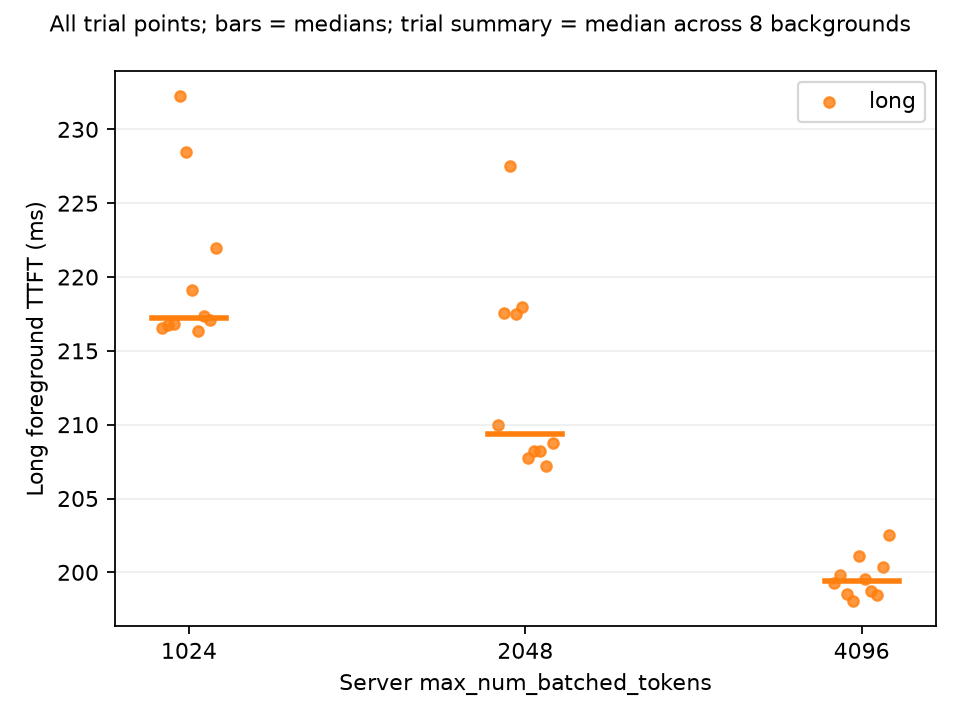
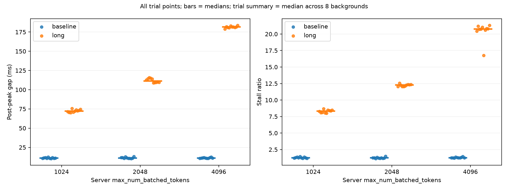
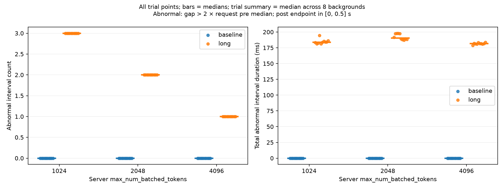
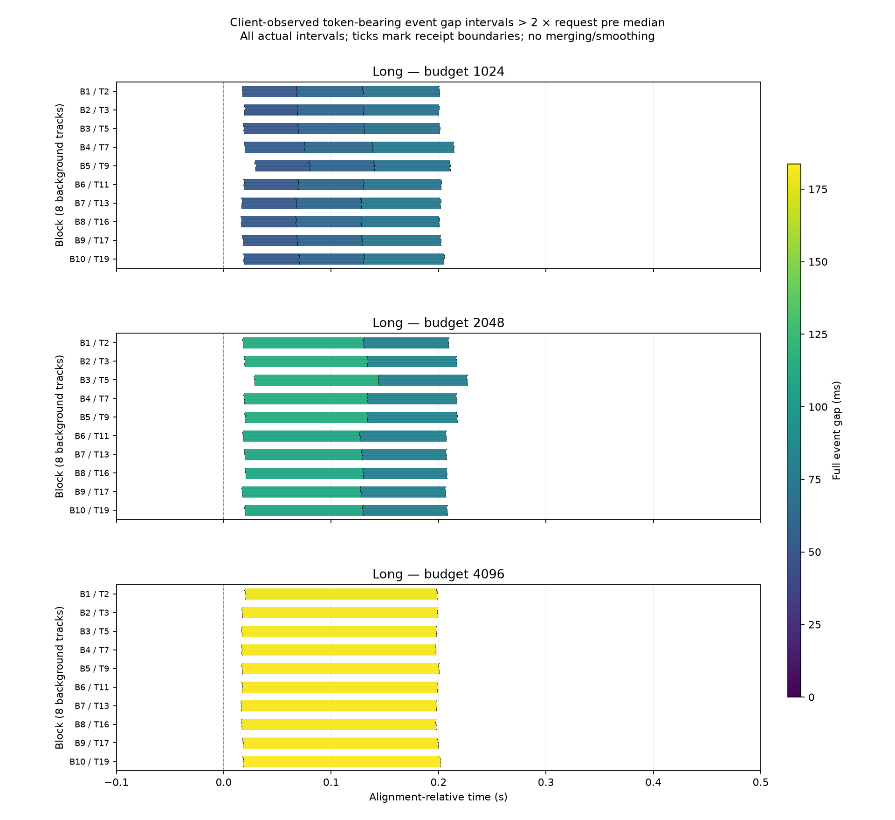
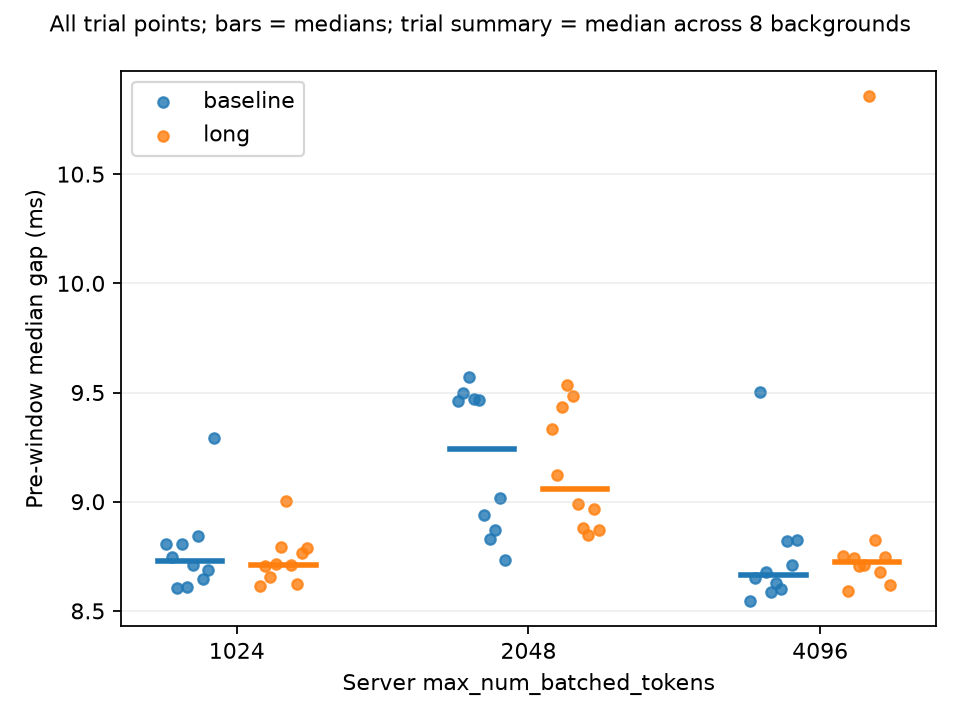
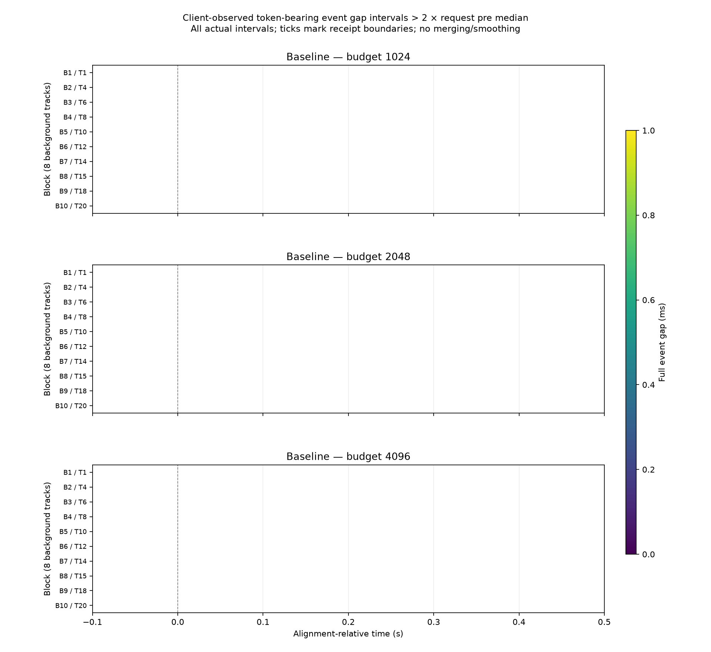

# Week 1 experiments

Selected result figures are preserved in `pics/` with descriptive names and embedded
below. Each section identifies its source run; original CSV/PNG outputs remain in
gitignored `results/`. These copies let the notes retain their figures in Git.

## Prompt length

**Question:** How does prompt/context length affect TTFT and decode performance?

**Controlled:** Qwen/Qwen3-0.6B, concurrency 1, maximum output 64 tokens.

**Variable:** Prompt length.

**Method:** Five repetitions per size, randomized order, unique per-request prefix, one uncounted warmup; medians reduce sensitivity to individual outliers.

**Illustrated run:** `20261006-222435`, from `results/prompt_length-20261006-222435.csv`. This is the only archived prompt-length run available in `results/`: all five sizes have five complete samples, with 64 output tokens and finish reason `length` throughout. The summary below uses this CSV so its numbers and figures refer to the same run.

**Observed in the illustrated run:** Median actual prompt lengths were approximately 77, 180, 588, 1135, and 2229 tokens. Median TTFT was 11.8, 14.6, 31.4, 55.3, and 120.4 ms. Median decode throughput was 172.182, 171.345, 167.733, 159.760, and 140.928 tokens/s.

**Interpretation:** Longer prompts add Prefill work and strongly increase TTFT. Decode also slows somewhat because each new query attends over more historical KV. In this workload, TTFT is much more sensitive to prompt length than TPOT.

**Figures:** Raw samples and group medians from the illustrated run.

**Caveats:** These are client-observed measurements over localhost, on one RTX 4060 Laptop GPU, with the small Qwen3-0.6B model. This is an educational experiment, not a hardware benchmark score.

## Output length

**Question:** How does output length affect E2E latency and Decode performance when prompt workload is approximately fixed?

**Controlled:**

- model = Qwen/Qwen3-0.6B
- concurrency = 1
- fixed prompt body; actual prompt ≈ 577 tokens

**Variable:** Output length / max_tokens.

**Method:**

- 5 repetitions
- randomized order
- unique early request prefix
- fixed base prompt body
- one uncounted warmup
- medians

**Illustrated run:** `20261006-225619`, from `results/output_length-20261006-225619.csv`. Three archived output-length runs were checked; all have five complete samples at each of the five output limits and finish reason `length` throughout. The latest complete run is used for both figures, retaining all 25 samples rather than selecting individual points or combining runs.

**Results:** Tested output limits of 16, 64, 128, 256, and 512 tokens; actual outputs reached each limit. In the illustrated run, actual prompt lengths stayed clustered around 574–581 tokens. TTFT medians remained approximately constant at 32.5–34.7 ms. E2E latency increased approximately linearly with generated length. Client-observed TPOT medians were approximately 6.3–6.6 ms/token, with visible raw variation. The earlier runs also show variation and occasional outliers, particularly for shorter outputs.

**Interpretation:** Longer outputs mainly add Decode steps and increase total E2E latency. Current data does not support a strong monotonic increase in TPOT with output length.

**Figures:** Raw samples and group medians from the illustrated run.

**Caveats:** Client-observed measurements over localhost with Qwen/Qwen3-0.6B on a single RTX 4060 Laptop GPU.

## Concurrency

**Question:** Under a fixed homogeneous workload, how does client concurrency affect aggregate generation throughput, TTFT / E2E latency, engine Running / Waiting, and the KV-cache working set? Where do throughput gains begin to diminish?

**Controlled:**

- Fedora, Python 3.12, vLLM 0.31.0, one RTX 4060 Laptop GPU (~8 GB VRAM).
- Qwen/Qwen3-0.6B, `--gpu-memory-utilization 0.75`, `--max-model-len 4096`; other scheduler/batching settings kept at the baseline.
- Fixed instruction and body reused from the output-length experiment, with a unique UUID at the beginning of every request.
- `temperature=0`, `max_tokens=128`, streaming requests over localhost; Prefix Cache remained enabled.

**Variable:** Client concurrency = 1, 2, 4, 8, 16, 32, tested in ascending order.

**Method:** One closed-loop sweep: three excluded global warmup requests, then approximately 2*C warmup completions per level. Each completed request was immediately replaced to maintain approximately C in flight; warmup transitioned continuously into measurement. Collected exactly 128 latency samples per level whose request starts were at or after t0. After the cutoff, stopped replenishing, took t1, drained remaining requests, and waited for Running=Waiting=0 before advancing. See [the formal protocol](concurrency-experiment.md).

Generation throughput uses server Counter deltas divided by the t0/t1 observation interval. Server-window work includes boundary-crossing requests and is a different population from the 128 client samples. Gauges were sampled approximately every 0.2 s, with arithmetic sample mean and peak. Client TTFT ends at the first non-empty content chunk; E2E ends after consuming the full stream; TPOT divides the post-first-content duration by completion_tokens-1. Latency p50/p95 use nearest rank.

**Run:** `20261010-231439-7f9be14b`, 2026-10-10, local time Asia/Shanghai. Source files: `results/concurrency-20261010-231439-7f9be14b-{requests,levels,metrics}.csv` (generated files remain gitignored). The earlier C=1/2, four-sample smoke test was only an integration check and is excluded from these findings.

**Results:** All six levels collected 128 valid samples, 768 total. Actual prompt-token medians were 577 at every level, with an overall range of 570–581. Every measured response generated 128 tokens and finished with `length`. All levels recorded zero local-cache-hit tokens, external-transfer tokens, and preemptions; logical prompt-token deltas matched local-compute deltas.

| Concurrency | Generation tokens/s | TTFT p50 / p95 (ms) | E2E p50 / p95 (s) | TPOT p50 / p95 (ms/token) |
|---:|---:|---:|---:|---:|
| 1 | 158.7 | 33.2 / 36.4 | 0.797 / 0.848 | 6.02 / 6.39 |
| 2 | 288.5 | 41.8 / 58.7 | 0.883 / 0.887 | 6.65 / 6.68 |
| 4 | 500.8 | 107.5 / 109.3 | 1.022 / 1.024 | 7.20 / 7.73 |
| 8 | 784.9 | 132.9 / 178.5 | 1.304 / 1.306 | 9.21 / 9.90 |
| 16 | 1157.0 | 213.5 / 287.4 | 1.765 / 1.795 | 12.23 / 13.43 |
| 32 | 1415.2 | 277.4 / 379.1 | 2.884 / 2.971 | 20.49 / 21.56 |

| Concurrency | Running mean / peak | Waiting mean / peak | KV block-pool usage mean / peak (%) |
|---:|---:|---:|---:|
| 1 | 0.95 / 1 | 0 / 0 | 1.66 / 1.94 |
| 2 | 1.94 / 2 | 0 / 0 | 3.39 / 3.84 |
| 4 | 3.38 / 4 | 0 / 0 | 5.84 / 7.43 |
| 8 | 7.51 / 8 | 0 / 0 | 13.03 / 15.29 |
| 16 | 14.90 / 16 | 0.013 / 1 | 25.78 / 30.41 |
| 32 | 30.11 / 32 | 0 / 0 | 52.21 / 60.39 |

The sole sampled Waiting=1 observation occurred at C=16 with reason `capacity`; deferred waiting stayed zero. This reason alone does not establish KV exhaustion. Running is not GPU batch size, and KV usage describes the vLLM block pool, not total GPU VRAM.

**Interpretation:** Increasing concurrency raised aggregate generation throughput while slowing individual requests. For successive concurrency doublings, throughput gains decreased from 81.7% to 73.6%, 56.7%, 47.4%, and 22.3%. From C=16 to 32, throughput increased 22.3%, but E2E p50 increased 63.4% and TPOT p50 increased 67.6%; Decode slowdown is an important part of the additional latency cost.

The 16–32 range is a candidate region of diminishing returns under this workload, not a proven exact saturation point: throughput still increased at C=32. Running and KV usage increased, but sampled Waiting showed no sustained backlog and no preemption was recorded. The data does not establish KV-capacity exhaustion or identify a specific GPU bottleneck. E2E p95 generally remained close to p50, suggesting broad request slowdown rather than a pronounced extreme tail in this run.

**Plots:** Generation throughput, TTFT p50/p95, and E2E p50/p95 are the original primary plots. TPOT p50/p95, KV usage mean/peak, and Running mean/peak with a client-concurrency reference line were added post hoc as diagnostic / learning plots, using the same recorded levels CSV without new inference or independent evidence.

All six figures below use the formal run `20261010-231439-7f9be14b` identified above.

**Primary plots:**

**Post-hoc diagnostic / learning plots:**

**Caveats:** One ascending sweep on one machine, with no repeated runs or confidence intervals. GPU temperature, frequency, power, and background activity were not strictly controlled; no formal GPU profiling was collected. Measurement windows ranged from about 104 s at C=1 to 14.5 s at C=32. The 128 requests share runtime/scheduling conditions and are not 128 independent replications. Gauge sampling can miss brief waits/peaks, and snapshot timing/exporter refresh introduce boundary uncertainty. Fixed-concurrency closed-loop traffic does not establish behavior under a fixed external arrival rate. Findings apply to this model, workload, baseline configuration, and hardware.

## Mixed Prefill–Decode interference

**Question:** When a fixed cohort is already decoding, does injecting a new Prefill workload produce a temporary, client-observed output stall? How does the response change between a small prompt and a prompt exceeding one scheduler token budget?

**Controlled:**

- Fedora, Python 3.12, vLLM 0.31.0, one RTX 4060 Laptop GPU (~8 GB VRAM).
- Qwen/Qwen3-0.6B, `--gpu-memory-utilization 0.75`, `--max-model-len 4096`; the serving script and scheduler settings were unchanged.
- Baseline configuration: Chunked Prefill enabled, scheduler token budget 2048, max sequences 256, FCFS, AsyncScheduler, Prefix Cache enabled.
- Eight background requests submitted once per trial, without replacement. Each used the output-length/concurrency prompt material with a unique UUID prefix, approximately 577 actual prompt tokens, `temperature=0`, and `max_tokens=512`.
- Foreground requests used `temperature=0`, `max_tokens=1`, and a new early UUID prefix, limiting sustained extra Decode contention after Prefill.

**Variable:** Baseline = no foreground; Short = one foreground prompt targeting approximately 577 tokens; Long = one foreground prompt targeting approximately 3072 tokens, with actual usage required to exceed 2048.

**Method:** One excluded warmup cohort with C=8 and output limit 64. Each recorded trial waited until all eight background streams had accumulated at least 64 generated token IDs, then recorded the trigger and each request's actual progress. Baseline used that trigger as its alignment time. Short/Long aligned to the client timestamp immediately before the foreground API call. All requests completed before engine idle was checked and the next trial began.

The formal schedule contained 10 blocks, each with exactly one Baseline, Short, and Long trial in a seeded random order (`seed=20261011`), for 30 trials total. Blocks spread each condition throughout the run to reduce systematic thermal/time drift. See [the experiment protocol](prefill-interference-experiment.md).

Every parsed streaming event was recorded in memory with a client monotonic timestamp and incremental `token_ids`; final usage validated both prompt counts and total generated IDs. A token-bearing event can contain multiple tokens. The primary observable is therefore **client-observed token-bearing event gap**, not GPU-side per-token Decode latency. This experiment did not use average TPOT as its primary metric.

For each background request, gap = the difference between successive token-bearing event receipt times. The later event determines window membership: pre `[-0.5,0)` s and post `[0,+0.5]` s. Each request's stall ratio = post maximum gap / pre median gap; each trial's ratio = the median of its eight request ratios. Both windows required at least two gaps per request. The pre-gap and post-peak columns below are condition medians of trial-level summaries, each itself the median across eight request values; the reported stall ratio is not their quotient.

**Run:** `20261011-213351-40137cab`, 2026-10-11, local time Asia/Shanghai. Sources: `results/prefill-interference-20261011-213351-40137cab-{events.jsonl,trials.csv,metrics.csv,analysis.csv}`. The earlier three-trial smoke run `20261011-211120-78a1b24d` checked integration and is excluded from these findings. All figures below use the formal run, with timeline improvements generated offline from its unchanged raw events.

**Results:** All 30 trials completed successfully and passed analysis validity, with 10 trials per condition. Each background reached the trigger exactly once; recorded progress ranged from 64 to 66 tokens. All 240 backgrounds generated 512 tokens: 239 finished with `length`, one with `stop`. All 20 foregrounds generated one token and finished with `length`. Background actual prompt lengths ranged from 572 to 581 tokens. Short foregrounds ranged from 575 to 580; Long foregrounds ranged from 3068 to 3074, all above the 2048-token scheduler budget.

Raw-event replay validated the generated-ID/usage match and event cumulative counts for all 260 recorded requests; prompt-ID counts also matched usage. Backgrounds produced 122,880 token-bearing events, all singleton in this run: 1-token events 100%, 2-token and >=3-token events 0%, maximum delta=1. Including foregrounds gives 122,900 token-bearing events, within 123,420 total parsed SSE events. This observation does not guarantee singleton delivery in future runs; multi-token handling was tested synthetically.

| Condition | Trials | Pre median gap (ms) | Post peak gap summary (ms) | Trial stall ratio median (min–max) | Foreground TTFT median (min–max, ms) |
|---|---:|---:|---:|---:|---:|
| Baseline | 10 | 8.509 | 11.045 | 1.297 (1.218–1.638) | — |
| Short | 10 | 8.513 | 32.657 | 3.834 (3.635–4.002) | 50.517 (48.805–52.119) |
| Long | 10 | 8.511 | 107.704 | 12.576 (10.192–12.897) | 199.691 (198.423–234.192) |

All trials had zero local-cache-hit tokens, external KV-transfer tokens, and preemptions. Across the run, logical prompt tokens equalled local-compute tokens at 174,971; generation tokens totalled 122,900. Engine Gauges were sampled approximately every 0.2 s, with 849 samples total. Running peaks for Baseline/Short/Long were 8/8/9, Waiting/capacity/deferred stayed zero, and the largest sampled KV block-pool fraction was 23.55%. Every trial's final idle observation had Running=Waiting=KV usage=0. Short's brief extra request can escape 0.2 s sampling; its sampled Running peak of 8 does not imply the foreground was absent.

**Interpretation:** Within this run, both injected workloads coincided with larger transient background stream gaps than the no-injection control, with Long producing larger gaps than Short. Background intervals returned to their usual short cadence after the injection region; the effect is localized rather than summarized only by whole-request average TPOT.

For the post-hoc stall-only diagnostic, each request used its own pre median and a strict threshold `gap > 2 × pre_median_gap`. Actual thresholds ranged from 16.82 to 21.39 ms. No Baseline request exceeded its threshold within the plotted `[-0.5,+1.0]` s window. Every Short background had one post-alignment interval exceeding its threshold, and every Long background had two. Short trial B8/T22 additionally had a pre-alignment anomaly shared across all eight requests; it is retained rather than attributed to the later injection. The multiple Long intervals are consistent with a Prefill workload spanning token-budget iterations, but client events do not identify GPU scheduler iteration boundaries.

**Plots:** The full-interval timeline preserves every observed gap as `[previous event receipt, next event receipt]`, with separate Baseline/Short/Long panels, one row per trial, and eight background tracks per row. B denotes randomized block (1–10), T denotes overall execution order (1–30). Length and color encode the complete gap duration, and ticks mark actual event receipts. There is no temporal binning, smoothing, or cross-trial aggregation; adjacent normal gaps can visually join into a continuous track.

The stall-only timeline was added post hoc for readability, using the per-request 2× threshold above and the same true interval endpoints. Its threshold is a visualization rule, not a statistical significance test or a universal definition of stall. The stall-ratio and foreground-TTFT plots retain one point per trial plus condition medians. All four figures are derived from the same formal run; no additional inference was needed to produce the revised timelines.

**Primary views:**

**Post-hoc diagnostic / learning view:**

**Caveats:** One 30-trial run on one machine. Blocks reduce condition/order confounding but do not strictly control temperature, GPU clocks, power, or background activity. Eight streams within a trial share serving conditions and are not eight independent experiment replications. Client receipt times also include HTTP/SDK/event-loop/OS effects; even singleton events do not expose GPU generation timestamps. Foreground request-start alignment is not the GPU Prefill start. Gauge sampling cannot resolve these short pauses, and a gap crossing a window boundary is assigned by its later event. Chunked Prefill was enabled throughout: there is no on/off control, so these results cannot establish a causal TPOT improvement from Chunked Prefill, exact GPU stall durations, or the scheduler cause of each observed gap.

## Token budget / Chunked Prefill

**Question:** With the same active Decode cohort and Long Prefill workload, how does the scheduler's total token budget change client-observed Decode stall structure and foreground TTFT?

**Controlled:**

- Fedora, Python 3.12, vLLM 0.31.0, one RTX 4060 Laptop GPU (~8 GB VRAM).
- Qwen/Qwen3-0.6B, `--gpu-memory-utilization 0.75`, `--max-model-len 4096`; Prefix Cache and Chunked Prefill enabled throughout. Only `--max-num-batched-tokens` changed between server blocks.
- Eight background requests submitted once per trial, without replacement, using the previous experiment's prompt construction: approximately 577 actual prompt tokens, a unique early UUID prefix, `temperature=0`, and `max_tokens=512`.
- Baseline injected no foreground; Long injected the same approximately 3070-token prompt construction, with a unique early UUID prefix, `temperature=0`, and `max_tokens=1`.
- The 512-token background limit remained an upper bound. Natural stop was accepted only when the request succeeded, IDs matched final usage, the trigger was satisfied, and the lifecycle covered the entire `[-0.5,+0.5]` s analysis window. A terminal finish event before +0.5 s invalidated the trial even if final usage arrived later. `ignore_eos` was not enabled.

**Variable:** Server-side `max_num_batched_tokens` = 1024, 2048, 4096. No 512-budget extension was run. The client budget label was metadata only; the actual budget was supplied when launching vLLM.

**Method:** A new 2048 smoke server ran one excluded C8/output64 warmup and one Baseline/Long block. After successful validation and shutdown, formal server blocks ran in the fixed non-monotonic order **2048 → 4096 → 1024**. Each fresh server ran one excluded C8/output64 warmup and ten blocks, each containing one Baseline and one Long in seeded random order (`seed=20261012`), giving 20 trials per budget and 60 total. Servers were restarted between budgets, not between trials. Each trial waited for the previous workload to drain, with Running=Waiting=0 and near-idle KV usage. Server readiness was polled; shutdown used SIGINT, verified owned-process exit and port release, and did not touch pre-existing processes. See [the protocol and execution history](token-budget-experiment.md).

Alignment and measurement reused the Mixed Prefill–Decode runner: all eight backgrounds had to accumulate at least 64 generated IDs while still active. Baseline aligned to the trigger; Long aligned to the client timestamp immediately before its foreground API call. Streaming `return_token_ids=True` events were timestamped with `perf_counter_ns()`, with final usage checks. The observable remains **client-observed token-bearing event gap**, not GPU-side token timing or kernel ITL.

Pre/post windows remained `[-0.5,0)` / `[0,+0.5]` s, with membership determined by the later event receipt and at least two gaps in each window per request. Each request's ratio was post peak / pre median; trial summaries were medians across eight backgrounds. A significant interval was strictly `gap > 2 × request pre median`; counts and sums of full interval durations were computed per request, then summarized by the eight-request median. “Significant” is a threshold label, not a statistical significance test. Counts are raw abnormal intervals, not merged intervals or scheduler chunks.

**Pre-experiment hypothesis:** The local source audit predicted approximately 4/2/1 Prefill scheduling rounds at budgets 1024/2048/4096 under idealized eight-token Decode allocation, with no cache hits or KV pressure. Smaller budgets might produce shorter individual stalls, more phases and longer foreground TTFT; larger budgets might produce fewer but heavier mixed iterations. Runtime efficiency, overhead and async scheduling could make relationships non-monotonic. Client stall counts were not required to equal scheduling rounds.

**Run:** `20261012-210208-840f1f50`, 2026-10-12, local time Asia/Shanghai. Sources: `results/token-budget-sweep/20261012-210208-840f1f50/`, containing per-budget events JSONL, trials/metrics/analysis CSVs, server logs and startup metadata, plus cross-budget summaries and paired comparisons. The separate smoke `smoke-20261012-210208-840f1f50` is excluded. Earlier failed smoke and partial formal runs, their postmortems and the later offline rule review remain archived and were not relabeled or pooled into this final run. All figures below are copies of the final run's generated plots, archived under `notes/pics/` for versioned documentation.

**Results:** All 60 trials passed the current `window-coverage-v2` validity rule, with 10 Baseline and 10 Long per budget. Independent offline replay rechecked all 510 measured requests: 480 backgrounds and 30 foregrounds, with consistent cumulative IDs and final usage. All backgrounds met trigger and window coverage; all foregrounds generated one token. Of the backgrounds, 479 generated 512 tokens; one in 2048 Long trial 5/background 0 naturally finished with `stop` at 485 tokens and request end +4.691 s, well after the analysis window. No trial was replaced or excluded. Long actual prompt ranges were 3067–3075 at 1024 and 3069–3073 at 2048/4096.

Values below are condition medians of trial-level summaries; parentheses give trial min–max. The post-peak column is the median of each trial's eight request peaks, not the cohort-wide maximum. Ratio is the median of request ratios, not the quotient of the displayed pre/post aggregates.

| Budget | Baseline pre gap (ms) | Baseline post peak (ms) | Baseline stall ratio | Long post peak (min–max, ms) | Long stall ratio (min–max) | Long TTFT (min–max, ms) |
|---:|---:|---:|---:|---:|---:|---:|
| 1024 | 8.730 | 10.953 | 1.253 | 72.287 (70.248–75.573) | 8.326 (8.017–8.669) | 217.224 (216.376–232.246) |
| 2048 | 9.239 | 11.244 | 1.230 | 111.453 (108.850–115.648) | 12.281 (12.035–12.544) | 209.377 (207.218–227.495) |
| 4096 | 8.665 | 11.028 | 1.267 | 181.705 (178.756–183.637) | 20.769 (16.741–21.308) | 199.408 (198.049–202.511) |

| Budget | Long significant interval count (min–max) | Long total significant duration (min–max, ms) | Paired Long−Baseline post-peak difference median (ms) |
|---:|---:|---:|---:|
| 1024 | 3 (3–3) | 183.844 (181.047–194.682) | 60.988 |
| 2048 | 2 (2–2) | 190.428 (187.226–198.064) | 99.929 |
| 4096 | 1 (1–1) | 181.705 (178.756–183.637) | 170.222 |

All Baseline requests had zero significant post-window intervals. Baseline pre medians differed by about 6.6% across server blocks; they were not assumed identical. The within-block paired comparisons above and in `paired-comparisons.csv` retain a same-budget control.

| Budget | Startup KV capacity (tokens) | Available KV memory (GiB) | Sampled KV peak (%) | Token-bearing events including foreground | Singleton ratio (%) | Max delta |
|---:|---:|---:|---:|---:|---:|---:|
| 1024 | 34,608 | 3.70 | 25.16 | 81,930 | 100 | 1 |
| 2048 | 36,912 | 3.94 | 23.76 | 81,887 | 99.99023 | 3 |
| 4096 | 35,824 | 3.83 | 24.31 | 81,930 | 100 | 1 |

All trials recorded zero local Prefix Cache hits, external KV-transfer tokens and preemptions. Sampled Waiting/capacity/deferred remained zero, and final idle Running/Waiting/KV were zero. The runtime metadata confirms the requested budgets, model length, GPU fraction and enabled Prefix Cache/Chunked Prefill; fields not reliably exposed in startup logs, including max sequences and async scheduling, remain null rather than being filled from remembered defaults.

The eight multi-token events were all delta 3 in 2048 Baseline trial 10, one per background at about +1.247 s, outside the analysis windows. Offline audit checked both event endpoints: none of the 480 significant post-window intervals or 480 request post peaks touched a multi-token event. Long events were singleton throughout. The audit files and script are separately archived with the run; no token timestamps were interpolated within multi-token events.

**Interpretation:** In this run, larger budgets coincided with fewer above-threshold background gap intervals, larger individual peaks and lower foreground-TTFT medians. The total significant interval duration was similar in scale across budgets and non-monotonic, at approximately 182–190 ms. The clearest observed change was temporal distribution and peak size; the data does not identify a universally optimal budget.

The timeline repeatedly shows three adjacent abnormal intervals at 1024, two at 2048 and one at 4096. Median boundaries across the 80 Long background requests per budget were approximately 18–69/69–130/130–202 ms, 19–130/130–209 ms, and 17–199 ms respectively. Adjacent segments share an event receipt boundary; this does not establish sustained normal Decode between segments. The observed 3/2/1 interval counts are not direct measurements of the source-predicted 4/2/1 scheduling rounds.

4096 Long trial 11/block 6 had a higher pre median of 10.857 ms and a lower ratio of 16.741, while its absolute post peak 181.745 ms was close to the group median. It remains included. Upper TTFT values at 1024/2048 also remain visible rather than being removed.

**Independent replication sanity:** Yesterday's 2048 Long data is compared separately, never added to today's trials or plots. Today's 2048 again shows two above-threshold client intervals per background and larger Long gaps than Baseline; this is descriptive consistency, not an equivalence test.

| 2048 Long run | Trials | TTFT median (ms) | Stall ratio median | Post peak median (ms) |
|---|---:|---:|---:|---:|
| 20261011 independent | 10 | 199.691 | 12.576 | 107.704 |
| 20261012 current sweep | 10 | 209.377 | 12.281 | 111.453 |

**Plots:** Every distribution retains all trial points and group medians. Stall timelines use actual `[previous event receipt, next event receipt]` intervals, show all ten trials and eight background tracks per trial, and use the unchanged 2× threshold. B/T denote block/trial execution order. The display window is `[-0.1,+0.5]` s; thresholds still use the full pre window. Length and color represent full gap duration, with receipt-boundary ticks. No binning, merging, smoothing or representative-trial selection was applied. All six views were generated offline from this formal run.

**Primary views:**

**Baseline reference views:**

**Caveats:** One server block per budget, so budget remains confounded with block time despite the non-monotonic order. Recorded GPU temperatures at block starts were 61/70/73°C; clock, power and desktop activity were not strictly controlled. Startup profiling produced different KV capacities; pool usage stayed below 26% with sampled Waiting/preemption = 0, so no activation of capacity pressure was observed. Waiting = 0 does not mean no resource competition, and preemption = 0 does not mean no execution pressure. Approximately 200 ms gauge sampling can miss brief changes. UUID tokenization introduces small prompt-length variation; HTTP/SDK/event-loop/OS timing and async execution affect receipt gaps. Eight backgrounds share conditions within each trial and are not independent experiment replications. There is no scheduler iteration trace or Chunked Prefill on/off control. Startup dependency warnings and EngineCore/semaphore messages during shutdown are preserved in logs; all measurement validation, drain and owned-process/port-release checks passed. These observations describe this model/workload/hardware, not GPU-level stall durations or a general optimization proof.
